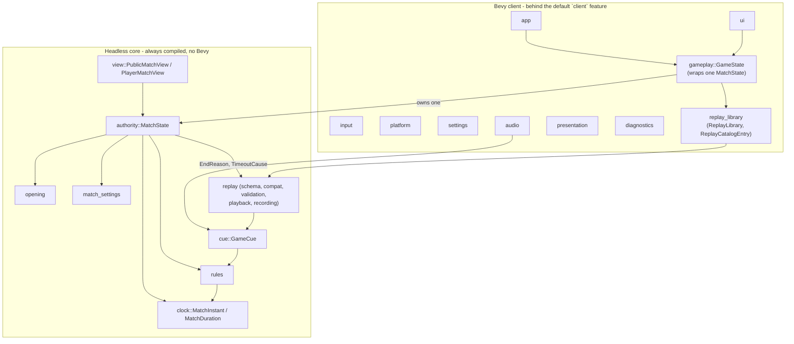
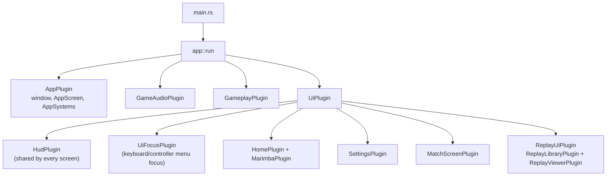
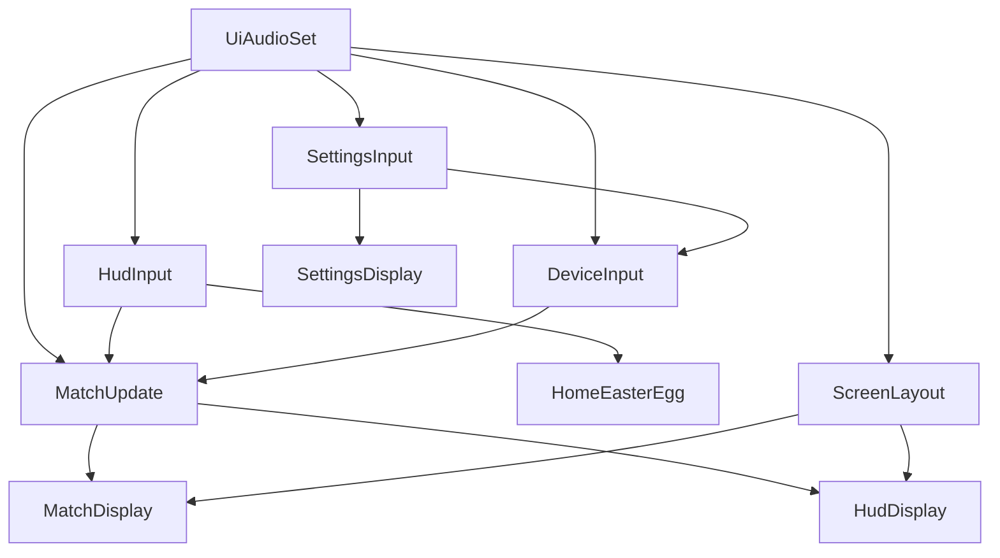
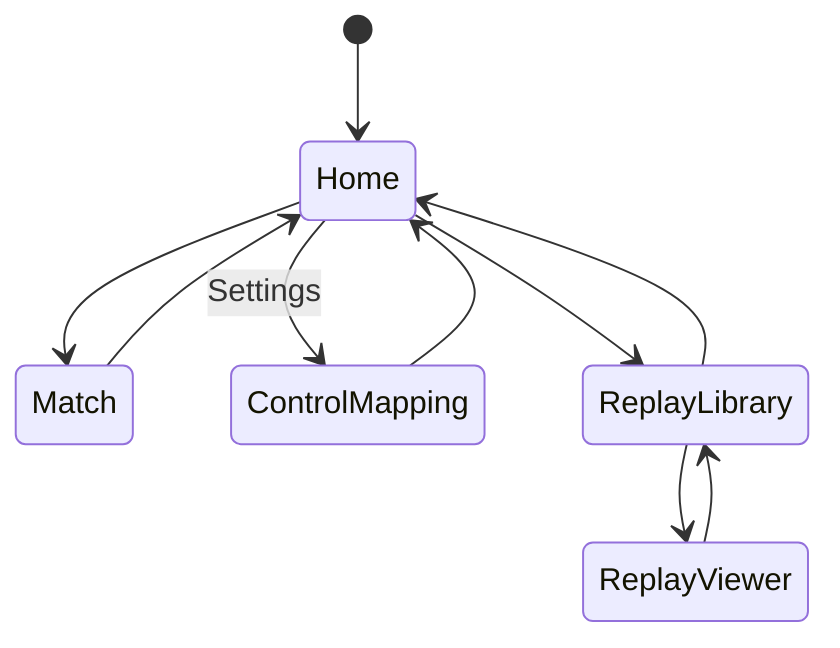
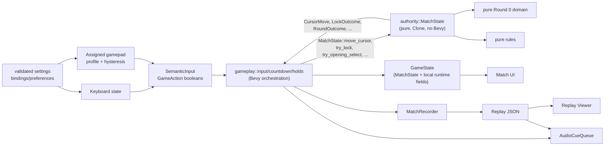
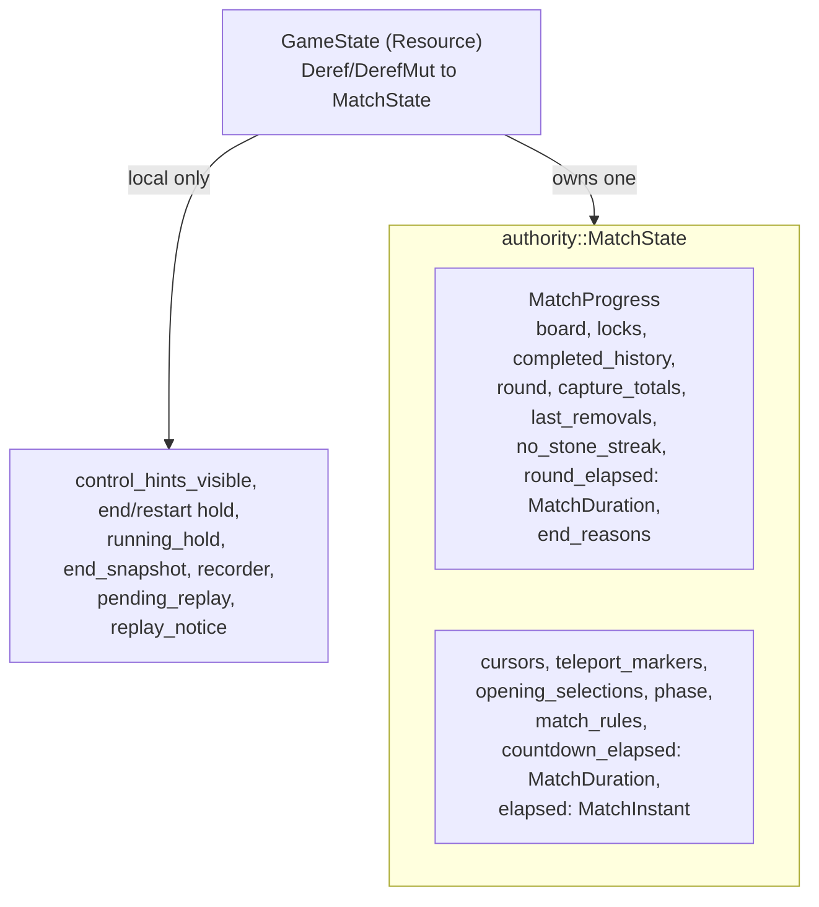
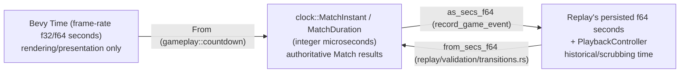
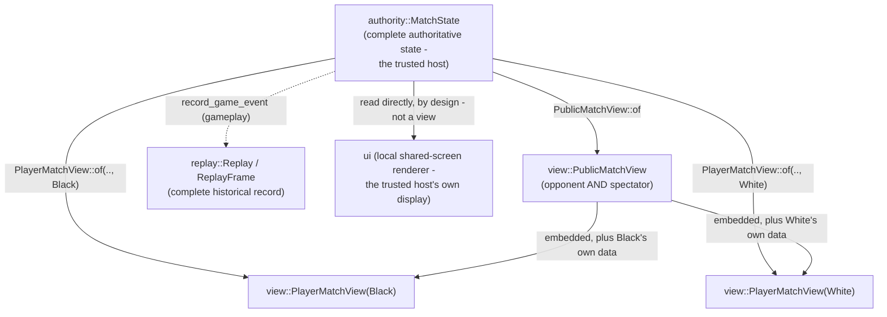
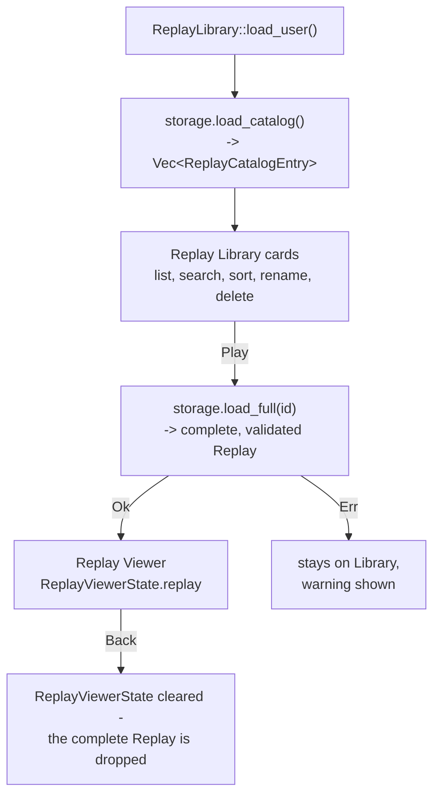
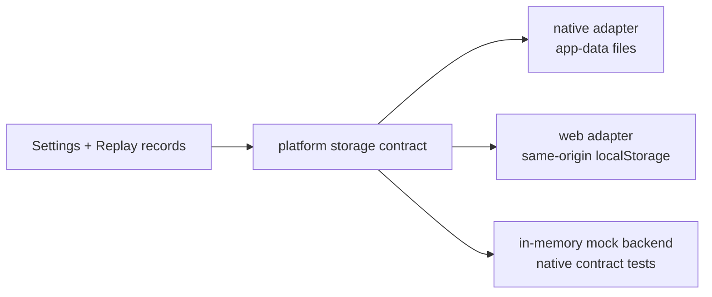

# Architecture

Go Together separates pure domain/data code from Bevy orchestration. The goal
is not to build a generic engine; it is to keep each game-specific flow easy to
find and test.

## Headless core and Bevy client

`go_together` is a library crate (`src/lib.rs`) with a thin binary on top
(`src/main.rs`, `cargo run`). The library splits into two layers, enforced by
Cargo module declarations and a feature flag rather than convention alone:



- **Headless core.** [`rules`](../src/rules/mod.rs), [`opening`](../src/opening.rs),
  [`match_settings`](../src/match_settings.rs), and
  [`authority`](../src/authority/mod.rs) compile with no Bevy dependency and need
  no window, renderer, audio device, or storage backend. `authority::MatchState`
  is the authoritative, `Clone`-able, deterministic Match state: board,
  cursors, Teleport Markers, hidden selections, positional-repetition history,
  round/Match clocks, capture totals, the immutable `MatchRules` snapshot, and
  official end reasons. Player intent reaches it through narrow command
  methods (`try_lock`, `try_opening_select`, `move_cursor`, ...), each
  returning a structured outcome (`LockOutcome`, `RoundOutcome`, ...) instead
  of a side effect, and Match time passes the same way: `advance_clock`
  advances its clocks to the next authoritative boundary - a countdown
  stage, the reveal, a Round Time or Match Time deadline - and reports it as
  a `ClockBoundary` for the caller to act on. See `authority`'s own module
  docs for the full contract,
  including why `RoundOutcome` carries a pure `RoundSound` rather than a Bevy
  audio cue, and why `MatchProgress::locks` (hidden selections) is `pub(crate)`
  rather than `pub`, preserving the same "no general accessor reveals both
  hidden choices" privacy the local client already relies on. `replay`'s
  `schema`, `compat`, `validation`, and `playback` submodules are pure data
  plus `serde`, and together they are a public API: a headless consumer
  loads a `replay::Replay` of any supported schema version with
  `Replay::from_json`/`from_value` (both validate before returning, and
  they are the only ways to obtain one - the fields are private and the
  type has no `Deserialize` impl), inspects it through accessors, writes it
  back in its own on-disk shape with `to_storage_json`/`to_storage_value`
  (likewise the only ways to serialize one - the type has no `Serialize`
  impl either, so the in-memory shape, which is not the file format, is not
  reachable from outside the crate), and plays it back
  through `PlaybackController`, exactly as the Replay Viewer does. `cue`'s
  `GameCue` is public with it, because a Replay records cues and playback
  reports them. `replay::recording` is core too - assembling a `Replay` from
  events is pure data work, and the one host-specific thing a new Replay
  needs, the local wall-clock text in its default label, is passed to
  `MatchRecorder` already formatted. `MatchRecorder` is nonetheless
  `pub(crate)`, and its module declaration is
  `#[cfg(any(feature = "client", test))]` so a headless non-test build does
  not report an item nothing calls: making it public would mean a consumer
  could hold a `Replay` that never passed `Replay::validate`, which is the
  invariant the whole public surface rests on. Storing and browsing Replays
  is not here at all - that is `replay_library`, behind `client`. See
  `replay`'s module docs for the tour of that surface
  and for why `EndReason` and `TimeoutCause` - the persisted enums
  `authority` produces - live in `replay::schema` rather than `authority`.
- **Bevy client**, gated behind the default `client` Cargo feature (`bevy`
  itself is an optional dependency, only pulled in when `client` is enabled):
  `gameplay` wraps one `authority::MatchState` in a Bevy `Resource`
  (`GameState`, `Deref`/`DerefMut` to `MatchState`) and drives it from input,
  the match clock, and hold gestures; `app` owns bootstrap and screen/system
  ordering; `ui` owns every screen; `input` translates physical devices;
  `settings`, `replay_library`, and `platform` persist bindings,
  preferences, and Replays - `replay_library` owning the in-memory
  collection the Replay Library screen browses, the way `settings` owns what
  the Settings screen edits; `audio` turns queued cues into sound;
  `presentation` is the shared colour vocabulary, and the only module that
  may construct a colour (`src/architecture.rs` holds the rest of the crate
  to that, so that `src/contrast.rs` can check every colour against the
  backgrounds it is drawn on); `diagnostics` turns typed
  errors into player-facing notices and is a deliberate leaf, depending on no
  other module so that it cannot learn which subsystem produced one. None of
  this is part of the crate's public API apart from the single entry point
  `run`, which `src/lib.rs` re-exports from `app` (behind `client`) for the
  binary to call.
- **Dependency direction is enforced, not just documented.** `cargo build
  --no-default-features --lib` compiles only the core - `cargo tree
  --no-default-features` shows `serde`, `serde_json`, and `uuid` as the only
  direct dependencies, each with its own small transitive tree, and no
  `bevy`/`wgpu`/`winit` anywhere in it (plus `proptest` under
  `[dev-dependencies]`, unaffected by this feature).
  `cargo test --locked --no-default-features`
  is an equally supported command, exercising the core's own tests
  (`rules`, `rules::properties`, `opening`, `match_settings`, `authority`,
  `clock`, `view`, and every submodule of `replay`) and the two integration
  tests that drive the public API
  the way an external consumer would - `tests/headless_match.rs` for a
  Match, driven both by commands and through time to completion, and
  `tests/headless_replay.rs` for loading, validating, inspecting,
  serializing, and playing back a Replay of every schema version, from the
  literal files under `tests/fixtures/replays/` - with no client dependency
  at all; CI lints and tests this configuration and the ordinary
  default-feature one as separate steps in the `native` job, both with
  warnings denied. `cargo build`/`cargo run` (default
  features) build the full client; the binary's `required-features =
  ["client"]` only documents that it needs the client, since `client` is
  already the default.
- **`replay`'s in-module example tests run headlessly, because its test
  fixtures do.** They did not always. `replay::test_support` used to hold
  both the Replay fixtures and three mock `platform::ReplayStorage`
  backends; because implementing that trait needs `client`, the whole
  module was gated `#[cfg(all(feature = "client", test))]`, and so was every
  `mod tests` that imported it - hiding 53 in-module tests of `compat`,
  `playback`, and `validation` from `cargo test --no-default-features` even
  though the code they test is core. The mocks are now
  `replay_library::test_support` and the fixtures stayed behind, so those
  blocks are bare `#[cfg(test)]`. That one change took the headless lib-test
  count from 97 to 164 (the 53, plus `recording`'s and `measurement`'s own
  tests, the label tests that had accumulated in `replay::library`, and two
  added to keep helpers with no other headless caller honest); the suite has
  grown since, and `cargo test --locked --no-default-features --lib -- --list`
  is what reports the count now.
  `tests/headless_replay.rs` is still the proof that matters for the
  *public API* - it reaches the same code only through `pub` items and only
  from the checked-in on-disk files under `tests/fixtures/replays/` (one per
  schema version plus richer shapes, each pinned byte-for-byte to the
  builder that produced it - a `replay::test_support` builder, or one
  defined beside the guard test in `replay::compat`). That guard test,
  `checked_in_fixtures_match_their_builders`, now runs in both
  configurations rather than only the client one.
- **A future authoritative host** (a server running the same Match logic with
  no window) would depend on this crate the same way `tests/headless_match.rs`
  does: construct an `authority::MatchState`, drive it with the command
  methods as it receives player commands over its own transport and with
  `advance_clock` from its own tick, and read the outcomes to decide what to
  broadcast. Networking, matchmaking, accounts, and
  a server executable are deliberately not implemented yet; the headless/client
  split only establishes the boundary such a host would build on.
- **Public exposure is deliberate.** Only the types and methods a headless
  consumer plausibly needs are `pub`: board/cell state, players/points,
  selections, opening rules, Match settings/rules, `MatchState`/`MatchPhase`,
  the command methods, `advance_clock` with its `ClockStep`/`ClockBoundary`
  outcome and the `opening_countdown_stage`/`opening_go_remaining` readers a
  host's display needs, the other outcome types (`RoundOutcome`,
  `LockOutcome`, `OpeningSelectOutcome`, `CursorMove`, `TeleportJump`), and
  the `clock::MatchInstant`/`MatchDuration` time vocabulary those commands take
  and return - see [Time and clock boundaries](#time-and-clock-boundaries) -
  `view::PublicMatchView`/`PlayerMatchView`, the privacy-scoped projections
  a future networked or spectator consumer would actually read - see
  [Match state privacy and trust boundaries](#match-state-privacy-and-trust-boundaries) -
  and Replay's surface, read-only apart from `Replay::rename`: `Replay`,
  `ReplayEvent`, `ReplayFrame`, and
  `PlaybackController` as types with private fields and public accessors,
  the persisted enums (`ReplayEventKind`, `ReplayPhase`, `EndReason`,
  `TimeoutCause`, `cue::GameCue`), `ReplayWinner` (what `Replay::winner`
  returns, and not itself persisted), the two error types, the
  schema-version and limit constants, `PLAYBACK_SPEEDS`, the label rule
  (`REPLAY_LABEL_RULE` and `validate_label`), and the loading, validation,
  storage-shape, renaming, and playback methods. `rename` is the one public
  mutation, and it applies the same label rule `validate_label` states, so
  even that cannot put a `Replay` into a shape validation would reject.
  Internal helpers - `MatchProgress::locks`, every field
  of the Replay types, the per-version loader and its `ReplayFile` shadow,
  the recording layer - stay `pub(crate)` or private, which is what keeps
  `Replay::validate` an invariant rather than a convention: nothing outside
  the crate can build or alter a `Replay` except through the functions that
  validate it.

## App and plugin composition

`src/lib.rs` declares every crate module and re-exports `app::run` (behind
`client`); `src/main.rs` only calls it.



`UiPlugin` adds `HudPlugin` and `UiFocusPlugin` itself rather than nesting
them under a screen, because both serve every menu screen rather than
belonging to one: the HUD's systems carry no screen gate at all - and
`HudPlugin` owns the one interactive entity that belongs to no screen, the
Help modal, spawned at `Startup` - and the
focus systems gate only the ring's navigation, and only *off* live play -
off the Match screen except while a HUD modal is open - with the candidate
collector, the indicator and the Help modal's keys ungated (its
closing everywhere, and F1's opening on Home and the Match by a check inside
the same system) and one Match-only exit (see `ui/focus.rs`'s module docs).

`AppPlugin` owns `AppSystems`, the shared set of `Update` stages the Home,
Settings, Match, HUD, and device-input systems schedule into. It is a small dependency
graph, not one blanket
pipeline: `configure_app_systems` (called from `AppPlugin::build`, and
directly by scheduling tests) declares only the edges below, each a real data
or behavioral dependency between the *representative* systems in those two
sets - not "the frame order." Every stage also runs after `UiAudioSet`, so a
button's hover cue is queued before anything that may react to that button
by despawning it. Its click cue needs no stage at all: `audio` observes
Bevy's `Activate`, the event every button activation is, and queues the cue
the moment it is triggered, in `PreUpdate` - before any stage runs.



Each edge exists for a specific reason, documented in full on `AppSystems`
itself:

* `HudInput -> MatchUpdate`: a modal a HUD button opens this frame (which
  sets `GameplayPause`) must block gameplay the same frame, not one frame
  late.
* `HudInput -> HomeEasterEgg`: the marimba's input handler reads `HudState`
  directly to suppress notes while a modal is open, so it needs this frame's
  modal state.
* `SettingsInput -> DeviceInput`: binding capture writes `KeyboardBindings`
  and `ControllerBindings`, and semantic fusion reads both, so fusion uses
  this frame's binding rather than last frame's. Capture holds
  `Res<ButtonInput<KeyCode>>` and so cannot consume the physical press; the
  newly bound key, still held, is reported as its semantic action from that
  frame on. That is harmless because the only `SemanticInput` reader not
  gated to Match is gameplay's input-release gate, which merely keeps that one
  action gated until the key is released.
* `SettingsInput -> SettingsDisplay`: display reflects this frame's
  capture/tab changes.
* `DeviceInput -> MatchUpdate`: gameplay reads fused semantic input, which
  must exist before it does.
* `MatchUpdate -> MatchDisplay`: the board/HUD render this frame's resolved
  state.
* `MatchUpdate -> HudDisplay`: the shared HUD display system reads
  `GameState` (for the Round and Countdown panels' visibility and the
  return-home modal's body text) in addition to HUD and binding state, so it
  needs this frame's Match state too.
* `ScreenLayout -> MatchDisplay` and `ScreenLayout -> HudDisplay`: the
  Match screen's layout pass writes where its nodes stand, and both display
  passes write other parts of some of the same nodes - the HUD's which of
  the timer, round, end-reason and countdown panels are shown, the Match's
  what its texts say and which hints and dot rows are drawn. Placing first
  means a display pass always sees its nodes where this frame's window puts
  them. It also means the layout pass need not keep to its own fields,
  since the display passes run after it and set theirs every frame; but
  the display passes must keep to theirs, since one that replaced a whole
  `Node` would undo the placement until the window's size next changed.
  `ScreenLayout` holds three more layout passes. Home's and Settings' share
  nothing with either display pass, and Settings' writes nothing its own
  screen's display stage does either: `SettingsDisplay` shows and hides the
  tab panels, the instruction, the error lines and the reset confirmation,
  none of which carries a placement, so no edge orders the two. The Help
  modal's pass runs on every screen, since the modal belongs to none: it
  places the modal and its columns, and `HudDisplay`, after it, shows the
  modal and fills the columns.

Every other pair of sets is deliberately left unordered. This project does
not enable Bevy's system-order-ambiguity diagnostics, so two unordered
systems are safe together only because each pair is runtime-mutually
exclusive (gated to different, non-overlapping `AppScreen`s) or touches
disjoint data - not because the ambiguity is silently tolerated. No feature
plugin orders itself against another feature plugin's systems; it declares
which `AppSystems` stage a system belongs to, plus its own
screen's `run_if` gate. The HUD's systems are in stages
(`HudInput`, `HudDisplay`, and the Help modal's placement pass in
`ScreenLayout`) but carry no screen gate, because they serve several
screens.

So for `HudDisplay` that safety has to be argued rather than read off a
gate: its one system, `update_shared_display`, is live alongside
`SettingsDisplay` and `MatchDisplay` and ordered against neither. (The
Match screen's layout pass writes the four HUD panels' nodes it shows and
hides, and is ordered before it for that reason.) It stays disjoint from
the two display stages in two ways. The text it fills carries a `UiRole`, as the
Match screen's does, and the two passes divide the roles between them. And
the buttons it styles are those carrying a `HudAction` - every frame it sets
their fill from the pointer state and switches their click cue on, or draws
its own Help page arrows disabled and silent at either end of the pages -
*except* a button its own screen has marked `ScreenStyled`. The Settings
tabs are the case that marker exists for: they carry a `HudAction` so their
activation is read with every other button's, and `update_settings_tab_buttons`
restyles them so the selected tab is drawn inert and silent. Before the
marker both systems wrote the tab's fill and click cue, disagreed about the
selected tab, and left the result to whichever ran last. A screen that
restyles a `HudAction` button of its own marks it `ScreenStyled`; the
alternative, an edge between the two display stages, would have fixed the
order and kept two systems rewriting one fill every frame.

The Replay Library and Replay Viewer are the exception to the stages.
Neither `ReplayLibraryPlugin` nor `ReplayViewerPlugin` puts a system in an
`AppSystems` stage at all: each registers one self-contained `.chain()`,
gated to its own screen and ordered `.after(UiAudioSet)` directly - the
same audio ordering every stage gets. That leaves those chains unordered
against every stage, which is safe for the same reason as above: the only
systems sharing mutable data with them, `handle_ui_buttons` on
`NextState<AppScreen>`, the marimba's input handler on `AudioCueQueue`,
and the Match's and Home's layout passes on the camera's `WorldFraming`,
which the Viewer's writes too, find nothing to act on or are gated off
while a Replay screen is up. Each chain begins with its layout pass, for a
reason of its own. The Library's places nothing: it marks the list for
rebuilding when a change of size changes what the page is built from,
first, so that every handler after it pages by the page the frame will be
rebuilt with. The Viewer's places the screen's nodes before the display
pass at the end of the chain shows and hides them - one node, the
countdown card's row, takes its place from the first and whether it is
shown from the second, and each writes only its own fields of it.

The nine edges above are the ordering *between* stages, not the whole
ordering story. Within a stage, a plugin that needs its own systems ordered
(Settings input capture and display, the Match gameplay pipeline, the HUD's
press-then-pause pair) still uses an explicit `.chain()` for that, and the
two Replay screens chain the same way outside any stage. Those
internal chains are held to the same standard: `GameplayPlugin`
([`src/gameplay/mod.rs`](../src/gameplay/mod.rs)) documents the data
dependency behind each link of the five-system `MatchUpdate` chain - the Match
clock's phase, `playing_delta` and `input_frozen_this_frame` writes, the input
gate, and the `pending_replay` handoff to the save system - so reordering it
is recognisable as a behavior change rather than tidying. See the `AppSystems`
doc comment and `configure_app_systems` for the authoritative inter-set edge
list, and `GameplayPlugin`'s doc comment for `MatchUpdate`'s internal one.

## State and screen flow

`AppScreen` is a Bevy `States` enum.



The Replay Viewer has no edge to Home: its header routes Back only to the
Library, and `replay_header_actions_are_exact_and_do_not_route_home` pins
that.

Help and the return-to-Home confirmation are modals, not separate
states. Screen plugins use the same lifecycle:

1. `OnEnter`: reset feature resources, then spawn entities. Two resources
   no screen resets. `HudState`: the Help modal it governs belongs
   to no screen, so `ui::hud` resets it on the transition itself, for every
   screen change at once (see [entity ownership](#screen-modal-and-persistent-entity-ownership)).
   And the camera's `WorldFraming`, which `app::visuals` puts back on the
   transition in the same way, so that undoing one screen's zoom is no
   other screen's entry to remember; a screen that frames its own scene
   writes it after that reset, on entry or in `Update` (see
   [The window's size, and what answers to it](#the-windows-size-and-what-answers-to-it)).
2. `Update`: run only while the corresponding `AppScreen` is active - with two
   deliberate exceptions. Home's marimba input handler is registered ungated
   so it keeps draining `KeyboardInput` messages consistently, and checks the
   screen itself before counting a note. Gameplay's `update_input_gate` is
   ungated so a gate armed on one screen can clear wherever the player is, as
   soon as the inputs that armed it are released. The HUD's systems are
   screen-agnostic by design and carry no gate either. `ui`'s focus systems
   (which run in `PreUpdate`, `PostUpdate` and `Last`, not `Update` - see
   `configure_app_systems`'s doc comment) gate the ring's navigation keys
   off *live play* rather than off a screen: off the Match except while a
   HUD modal is open, because the ring serves every menu screen alike,
   gameplay owns those keys during a Match, and a modal blocks gameplay
   input on the same predicate that admits the ring. The candidate
   collector and the indicator run everywhere - during live play nothing on
   the Match is focusable, so they have nothing to do - and so do the
   Help modal's keys (closing on every screen, F1 opening on Home
   and the Match alone, decided inside the one system) and the
   press-scoped release; the Match-only Escape/Start exit (whose back keys
   no gameplay binding can hold) is the one gated to a screen. All of it is
   itemized in `ui/focus.rs`'s module docs.
3. `OnExit`, if a screen needs one at all: reset a resource despawning cannot
   touch (Home's marimba counter, the Replay Viewer's playback session).
   Entity teardown itself needs no `OnExit` system to register - see below.

## Screen, modal, and persistent entity ownership

Every independently spawned screen root carries Bevy's built-in
`DespawnOnExit(that screen)` marker component, tagged at the exact call that
spawns it. Descendants may stay untagged because Bevy recursively despawns
linked children with their tagged root. `init_state::<AppScreen>()` (in
[`AppPlugin::build`](#app-and-plugin-composition)) wires this up automatically
for every `AppScreen` variant - there is no per-screen system to register, no
query to write, and nothing to forget when adding a new spawn call. An
independent root spawned without the marker will survive navigation into an
unrelated screen; apart from the application-persistent entities and the
self-despawning audio players below, that is a bug.

Four ownership lifetimes exist:

- **Application-persistent.** Spawned once at `Startup` with no screen tag at
  all, and never despawned: the `Camera2d`, the Help modal, plus the
  shared `StonePalette` material handles and the stone `Mesh2d` handle
  (resources, not entities, reused by every screen that draws a board). The
  camera and the handles exist because re-uploading the same mesh/materials
  on every screen transition would be pure waste; nothing about them is
  screen-specific but the camera's framing, which a screen with a
  world-space scene to place - the Match and the Replay Viewer for their
  boards, Home for its diamond - sets and every change of screen puts back -
  see
  [The window's size, and what answers to it](#the-windows-size-and-what-answers-to-it).
  The Help modal is here for a different reason,
  and is the category's first *interactive* member: it is reachable from two
  screens, Home and the Match, so no screen's lifetime is its own - see the
  modal-scoped bullet below for the rule it amends. Its root is spawned
  hidden by `HudPlugin` at `Startup`, `HudState::help_open` toggles its
  `Display`, and it is closed on every screen change by
  `close_hud_modals_on_screen_change`, a screen-agnostic system in
  `StateTransition` that resets `HudState` whenever a screen's `OnEnter`
  would run - one of the two resources reset on the transition itself rather
  than in an entering screen's `OnEnter` chain, because the modal it governs
  belongs to no screen. The camera's `WorldFraming` is the other, reset
  beside it for the same reason: no screen's entry is the right owner of
  undoing another's zoom.
- **Screen-scoped.** Everything else a screen spawns: the board, cursors, HUD
  text, opening-selection dots, the capture marks and their count lines,
  the hold-progress and round-time bars,
  per-screen decorative sprites. Tagged `DespawnOnExit(that screen)` and despawned automatically,
  recursively, the moment `AppScreen` changes away from it, by `bevy_state`'s
  own `despawn_entities_on_exit_state` system. One set of *assets* is
  screen-scoped too, on purpose: the six meshes and six materials of the
  Replay Viewer's hidden-selection marks are made by
  `spawn_viewer_selections` on each entry, held only by the entities that
  draw them, and freed when those despawn. That is a little of the waste the
  shared handles exist to avoid, spent so that the mark a hidden selection
  is revealed with is not lying in a resource the live Match shares. It is
  a convenience removed rather than a wall - a stone's own material could
  still be misused - and what holds the rule is
  `the_live_board_draws_no_hidden_selection` in `ui::match_screen`.
- **Modal-scoped.** A modal belonging to one screen (the reset-confirmation
  dialog, the return-home confirmation, the Replay Viewer's Key and Match
  Settings panels) is spawned exactly once, at the same time as the rest of
  its owning screen, tagged with that *screen* rather than a modal-specific
  lifetime. Opening and closing it toggles `Display`/`Visibility` on the
  already-spawned root; it is never despawned and respawned. This is
  deliberate: such a modal's true lifetime already matches its screen's (it
  cannot outlive the screen, and re-entering the screen should not have to
  remember whether the modal was left open), so giving it its own
  despawn/respawn cycle would only add a second cleanup path to keep
  synchronized with the first. Leaving the screen despawns the modal root
  with everything else, whether or not it was open. That reasoning holds
  for exactly the modals that have one screen, which is why the rule is
  stated as *a modal belonging to one screen*: the Help modal is
  reachable from Home and from the Match, so for it the sentence about
  lifetimes is simply untrue - it was spawned twice, once per screen, two
  entity trees with two lifetimes for one conceptual modal, and that
  duplication is what let the two copies differ (one had a keyboard focus
  ring and the other did not). A modal reachable from more than one screen
  therefore needs its own lifetime, and it has one: it is
  application-persistent, above. This amends the modal-scoped rule rather
  than rejecting it - modal-scoped stays right for a modal with one screen.
  The Replay Library's rename and delete dialogs are the one pair of modals
  outside this model: they are part of the wholesale rebuild described below,
  spawned only while `ReplayLibraryUiState::dialog` is `Some` and despawned
  and respawned with the rest of the screen on every dirty rebuild. A new
  Library dialog should follow that respawn path, not the toggle pattern.
- **Playback-scoped.** One-shot audio entities (`AudioPlayer` plus
  `PlaybackSettings::DESPAWN`, tagged `PlayingAudio`) are spawned by
  `play_queued_cues` in `PostUpdate` with no screen tag, and despawn
  themselves when the sample ends - or, if the asset failed to load, through
  `cleanup_failed_audio`. They deliberately outlive a screen change, which is
  what lets a button's click cue still be heard when that same activation
  navigates away and despawns the button.

One case still needs an immediate, non-state-transition despawn:
[`despawn_screen_entities_now`](../src/app/mod.rs) despawns every entity
tagged for a given screen *right now*, without waiting for an `AppScreen`
change. The Replay Library is the one caller: `refresh_library_screen`
rebuilds the entire screen - header, toolbar, card list and any open dialog -
in place after a search, sort, rename, or delete, or a change of the
window's size that changes how the screen is laid out, none of which change
`AppScreen`, so the built-in on-exit despawn never fires for that rebuild.
Every other screen relies on the automatic mechanism exclusively.

## The window's size, and what answers to it

The window opens at 1040x900 logical pixels, and every screen was first
laid out for exactly that. Every screen - the Match screen, Home,
Settings, both Replay screens and the Help modal - is now laid out for any
size from 1040x600 up, while the window itself is still fixed at the
opening size (`resizable: false`).

**One input.** `app::visuals::WindowSize` is the primary window's logical
size, kept equal to it by `track_window_size` in `PreUpdate` and written
only when the size really changes. A screen's layout is a pure function of
`WindowSize::layout()`, which is that size raised to the 1040x600 minimum,
so a window or a browser page smaller than the minimum is laid out as the
minimum would be. Three read a little more, which a change of size does
not change: the Replay Library's layout reads how many lines of notes stand
over its list; the Replay Viewer's reads its Replay's label, which cannot
change while it is open, to know whether the label takes a third line in
the window's header; and the Help modal's place reads the screen it is
open over - over the Match, where the Match's heading and board stand,
which are laid out from the size in their turn. `WINDOW_WIDTH` and
`WINDOW_HEIGHT` are only the opening size; nothing adapted positions itself
from them.

**Text never changes size.** Interface nodes are laid out in the window's
own pixels at their own sizes, so the 14px floor holds at every size. What
grows and shrinks is the world-space scene - the Match board and the
Replay Viewer's, each with every mark on it, and Home's diamond - and it
is placed and scaled by the main camera, not by moving or resizing the
scene. A screen writes `WorldFraming`, a zoom and the world point at the
window's centre, and `frame_main_camera` gives the camera that projection
scale and translation in `PostUpdate`, before the projection is
recomputed. `bevy_ui` never sees the projection. So `board_position`,
`GRID_SPACING` and the rest of the boards' geometry, and the tests of it,
are the same at every size, and every stroke keeps its proportion to the
cell. A screen with no world-space scene to place writes nothing:
`reset_world_framing_on_screen_change`, in `StateTransition` beside the
HUD's modal reset, puts the framing back to a scale of 1 over the origin
on every change of screen, so Settings and the Replay Library never
inherit a zoom. The Match and the Viewer write their framing every frame,
and Home on entry and whenever the window's size changes, all after that
reset. Text drawn in world space, as the Replay Viewer's score badges are,
is scaled by the camera as well, and the 14px floor's scan reads the sizes
text is set at, not a camera's zoom; so on a screen that zooms, such text
has to be counter-scaled or moved into `bevy_ui`. The Viewer
counter-scales its badges.

**The Match screen** (`ui::match_screen::geometry`) has two arrangements.
*Tall* is the 1040x900 layout, which in that window is the screen exactly
as it always was, pixel for pixel. *Wide* stands each player's stack
beside the board from the title row down, puts the round panel to the
heading's left and the Match timer to its right, and lets the board fill
the height between the title row and the band under it. Either, in a
window with more room than its board takes, stands centred down the window
as one piece. The board ranges from 0.70 of its own size at the minimum to
twice it. Which arrangement a window gets is the rule in
`ui::arrangement`, which the Replay Viewer chooses by too, each screen
from its own margins. Below the cap of twice the board's size, wide is
chosen where it gives the board more than 4% more room than tall: so every
window narrower than about 1.12 times its height is tall, and a wider one
is tall until wide gains that much. The margins are fixed pixels, so that
depends on the size as well as the shape - the opening shape stays tall up
to about 1182x1023 and is wide above it. Past the cap, the window's shape
alone decides - the choice its shape gets where the larger room just
reaches the cap - so a window keeps its arrangement however large it
grows. Nothing but the board shrinks, so the smallest windows are made to
fit by moving: the line of end reasons is never wrapped and the stacks
stand further from the board when it needs the room, the round panel takes
two lines beside the heading when one does not fit, and the band under the
board holds two lines of text or one with a bar. The module's docs give
the numbers. `ui::match_screen::layout` spawns each piece where the layout
says, marks it with its `MatchPlacement`, and moves it when the window's
size changes; the countdown card is placed over the same rows of the board
at any zoom by the rule `ui::countdown_card` shares with the Replay
Viewer, and the capture marks, being world-space, scale with the stones
they stand on.

**Home** (`ui::home::geometry`) stays centred at its own size. Its diamond
keeps its own size down to a window about 709 px tall, and in a shorter
one shrinks, through the camera, until its corners stay inside the window,
but never below the panel's height. The hidden marimba stands under the
panel where it always has beside the panel and the diamond, moving with
them in a taller window, wherever its bars - measured where they are
drawn, not by the instrument's node - stand at least 12 px above the
window's bottom there, which is in windows at least 848 px tall; in a
shorter one it stands upright beside the panel.

**The Replay Viewer** (`ui::replay::viewer::geometry`) has two
arrangements too, chosen by the same rule from its own margins. *Tall* is
the 1040x900 layout, pixel for pixel in that window but for a label that
takes three lines there, below. *Wide* lets the board fill the height
above the transport row, keeps Back and Match Settings in the top corners,
and stands the Replay's label, the timer, the round and the result line in
a column under Back; the transport row stays under the board. Either
centres the board across the window, where the countdown card is centred,
and stands centred down a window with room to spare, as the Match does.
The board ranges from 0.79 of its own size at the minimum to twice it.
With these margins, for a label that takes two lines in tall's header,
every window narrower than about 1.20 times its height is tall, so the
opening shape is tall at every size, and a window 1040 px wide is wide up
to 778 px tall. Wide's column holds any label - up to 60 characters,
wrapping onto as many lines as the column's width makes it - over the
longest timer, round and result lines. Tall's header gives the label the
two lines it always had room for, and sets it in as many whole characters
as fit in the middle of the header row with half a character to spare, so
that the rounding of its node's edges to the display's pixels cannot
change where its lines break. A label that takes three lines in a window's
header, its lines counted as `bevy_ui` breaks them (`ui::line_breaks`),
gets a line's more room above the board.
Where the window's height limits the board, as at 1040x900, that draws the
board a line smaller - 0.949 of its size there - with its bottom and the
transport row where they were; where the window has height to spare, the
header row rises half a line and the board and the transport row drop half
a line. It is decided for each window, since a wider header can wrap a
label onto more lines as well as fewer, so a resize across such a width
moves the board by a line for such a label; the turning points the
module's docs give for a three-line label are for the header of the window
in question. It is the one place where what a text says moves anything on
the screen - Help's columns, Settings' error line and the Library's search
field read their texts only to set them - and the Replay, and so its
label, cannot change while the screen is open. Such a label used to run
into the timer. The score badges are drawn at their own size whatever the
board's zoom, and placed in window pixels - their offsets from their
cursors, a pair's gap and the clamp at the window's edge - so they are
placed again when the window's size changes. The Key, too tall for a short
window, sets its rows in two columns below 722 px.
`ui::replay::viewer::layout` spawns each piece where the layout says and
moves it, through one `place` function and a `ViewerPlacement` on each
node, from a pass that runs first in the Viewer's own chain.

**Settings** (`ui::settings::geometry`) has two arrangements, chosen by
the window's height alone. *Tabs on top* is the 1040x900 layout, its
930x830 panel with the four tabs in a row, used in every window at least
854 px tall - the panel with 12 px above and below it. In the opening
window it is the screen exactly as it always was, and in a larger one the
same panel in the middle. A shorter window gets the *sidebar*: the panel
takes the window less a 10 px margin, up to 1400 px wide; the title, the
instruction and the Reset Controls and Back buttons share one row along
its top, the tabs stand in a column down its left side, and the tab fills
the rest. There Preferences sets its three switches side by side as cards,
the Game tab's rows close up from 77 and 65 px to 66 and 56 - at 1040x600
the tab would otherwise need 493 px of the 486 the sidebar leaves it, as
measured on 2026-11-28 - and
the Keyboard tab's shared Restart Match binding stands on one line beside
its heading. A binding error, which has no room for a line of its own
there, stands in the instruction's place in the top row while it is shown.
A message that fits its place, its lines counted as `bevy_ui` breaks them
(`ui::line_breaks`), is drawn as it always was; the text's node is the
place with its edges rounded to the display's pixels, so a message fits
only where it fits at the characters a pixel less than the place holds and
at those a pixel more. One that does not is set in the game's own lines,
broken at its spaces and a word longer than a line split, which `bevy_ui`
keeps as they are; where those are more than the place has room for, two
in the sidebar and one on top, it is cut to them, the last ending with
"...", and the log keeps it whole. The game's own messages are printable
ASCII and fit their place. Only the warning that the settings file could
not be loaded is ever set in the game's own lines, since it quotes the
file's path and what the file holds, which can be long or carry anything;
and `ui::line_breaks` follows printable ASCII alone, so a message with
anything else in it fits only on one line.
In both arrangements the two players' columns stand centred together, and
the order of travel is the same: the tabs, the tab's controls, Reset
Controls, then Back. The longest default row, the Controller tab's
`Select / Revise Selection` on `South Button`, keeps at least 12 px between
its halves at every width: in a window narrower than about 1058 px the
sidebar's margins narrow to give it that, by 5 px each at the minimum.
`ui::settings::layout` spawns each piece where the layout says, through one
`place` function and a `SettingsPlacement` on each node, and
`place_settings_furniture` moves them on a change of size, moving the
footer's two buttons between the panel's foot and the top row as well.

**The Replay Library** (`ui::replay::library::geometry`) shows a page of
as many cards as fit the window's height. A card is 142 px tall, and the
rest of the screen - the header, the toolbar, the notes above the list (a
browser's retention note, and the line counting Replays that could not be
read) and the paging row - is fixed height around the list: two cards at
the 1040x600 minimum, three in a 1280x720 laptop's maximised window, four
at 1040x900, twelve at 1920x1080 and sixteen at 2560x1440. The list is one
column held to 1126 px and centred, or in a window at least 1700 px wide
two columns side by side, held to 2200. In a window at least 1150 px wide,
Home, the title and the toolbar share one header row, the search field
narrowed from 500 px to 250, wherever that makes room for one more card.
The paging buttons and the wheel move the list a card at a time, or in two
columns a row of two, so that every card keeps its column. A change of size
rebuilds the page only where it changes what the page is built from - how
many cards a page holds, in how many columns, the header or the padding -
from `place_library_for_window` first in the screen's own chain. The
screen takes its width from the window by flex, its contents held to the
list's widest and centred and two columns a grid of two equal tracks, so
a change of width alone rebuilds nothing. The first card moves back where
the larger page would run past the list's end, and in two columns to its
row's first card, and the focus ring moves with the cards, so it stays on
the Replay it was on; entering the screen does the same, for a window
resized while another screen was shown.

**The Help modal** (`ui::help::geometry`) keeps its 820x760 and its one
column in every window at least 844x784. A smaller window gets two
columns: the modal takes the window less 12 px round it, up to 1588 px
wide, where each column is as wide as the one column's page, with tighter
padding and gaps, and sets its page in two columns 32 px apart, with Close
at the right end of the pagination row. `bevy_ui` wraps a text within its
own box but cannot carry it on into a second, so the game wraps the page
itself, at the characters a column holds - known before layout, the font
being monospaced - and divides it between the columns as it fills the
page (`geometry::split_page`): between two paragraphs wherever that fits
both columns, and within one where none does. At the minimum a column
holds 43 characters and 19 lines, and every page fits. Over the Match the
one column keeps four promises, the earlier giving way to none of the
later: inside the window with 12 px round it; the heading's line whole,
wholly clear of the modal's top edge or wholly under the modal; the board
covered, or framed evenly where it is larger than the modal; and a heading
the modal stands under cleared by 15 px, as in the opening window. It
stands at the place nearest the middle of the window, under the heading,
that keeps all four, and where none does, at the nearest over the heading.
Where neither keeps them all - a wide Match 831 to 839 px tall, and up to
848 px at 1063 px wide, whose board is a little smaller than the modal -
the gap gives way: the modal stands as low as the window allows, 6.2 to
15 px under the heading's line, still covering the board. So a pixel's
change of height moves it a pixel or less, except where the Match changes
arrangement and at one height for each width, where it passes over the
heading's line in one step of 47 to 56 px - between 871 and 872 px tall at
1040 px wide, 849 and 850 at 1062, and 830 and 831 from 1063 on - which no
rule that keeps the heading whole can avoid. `place_help_modal` moves it on
a change of size or of screen, in the `ScreenLayout` stage on every
screen, since the modal belongs to none.

**The tests** sweep every layout over `app::visuals::layout_sweep` - every
20 px from the minimum to 2560x1440, the named sizes, a few fractional
ones and a few larger windows - and hold that nothing overlaps, nothing
leaves the window, the board never falls below the smallest window's zoom
nor grows past twice its size, and at 1040x900 every position is the one
the screen always had, but for the Viewer's with a label that takes three
lines there; the real-layout tests run the same screens at the sizes in
`NAMED_WINDOW_SIZES`, through the game's own schedule where the order of
the passes matters. See [Pure tests versus ECS
tests](TESTING.md#pure-tests-versus-ecs-tests).

## Presentation: continuous vs change-driven display

The live Match board is 81 intersections, each a stone entity and a ring
entity behind it (the ring is shown only behind a white or gray stone - see
`stone_geometry` in [`app::visuals`](../src/app/visuals.rs)); the Replay
Viewer's is the same size again. Every display system in
[`ui::match_screen`](../src/ui/match_screen/mod.rs),
[`ui::hud`](../src/ui/hud.rs) and
[`ui::replay::viewer`](../src/ui/replay/viewer/mod.rs) runs once per frame
regardless, but a system running every frame does not mean it should *write*
every frame - an unconditional write marks a component changed even when the
new value equals the old one, which is what actually costs something further
down the pipeline (material/mesh re-extraction, Bevy UI relayout, text
re-shaping, and on the web, more JS/WASM boundary traffic). Since Bevy 0.20
that includes the UI's render data: it is retained between frames and
rebuilt only for a node whose layout, colours, text or visibility are marked
changed, so a write of an equal `BackgroundColor` or `Text` now costs that
node's re-extraction too, where 0.19 re-extracted every node every frame
whatever was written. Three mechanisms keep that cost tied to real change
instead of frame count:

* **Compare before writing.** `update_match_display`, `update_shared_display`
  and `update_viewer_display` compute the target value first and only assign
  it if it differs from the current one (`if material.0 != *handle { ... }`,
  and likewise for `Transform`, `Visibility`, `Node::display`,
  `BackgroundColor` and `Text`). A frame where nothing actually changed - the
  common case for the 81-cell board, since most frames touch at most a cursor
  or a clock - now marks nothing changed either. Note what this does and does
  not avoid: the *candidate* value is still built every frame in order to be
  compared, so the constant Replay Viewer and HUD strings (`ViewerText::Label`
  cloning `replay.label`, `replay_result_text`) still allocate a `String` per
  frame even though they cannot change while the screen is open. That is
  deliberate and still a clear net win - the write is what triggers text
  re-shaping and UI relayout, and that dwarfs a `format!`. Hoisting the
  constant strings to spawn time was considered and rejected: splitting each
  display system into "set once" and "refreshed every frame" halves costs more
  in clarity than the allocations cost in time. The one place the candidate
  is not built at all is the HUD's modal copy: the Help modal is
  application-persistent, so its three text roles would otherwise be
  regenerated - two `help_page` calls, the better part of a kilobyte of
  formatted text - on every screen, every frame, while hidden.
  `update_shared_display` skips a modal's text roles while that modal is
  closed and fills them on the frame it opens, which is before layout, so a
  remap made while the modal was closed is shown on its first frame and
  nothing is ever visibly stale. This is deliberately *not*
  gated on `GameState::is_changed()` or similar: `GameState` changes every
  frame the Match clock ticks, so a resource-level change check would not
  distinguish "the board changed" from "a second passed," and would defeat
  the purpose. Comparing the actual per-entity target value is what makes the
  distinction correctly.
* **Boundary-gated redraws**, for the Replay Viewer's board specifically.
  Unlike the live Match, a Replay's board, cursors, teleport markers,
  hidden selections and score badges are not independent per-frame state:
  playback changes them only by moving from one recorded event to the next
  (`Replay::playback_boundary_key`), and never between two events. The
  score badges also depend on the window's size, because they are drawn at
  their own size whatever the board's zoom and placed in the window's
  pixels. Only `round_elapsed_seconds` (feeding the Round-time text) is
  continuously interpolated between events. `update_viewer_display` caches
  the last-drawn `(replay_id, boundary key, window size)` in a `Local` and
  calls `update_viewer_board_visuals` only when that changes or the board
  has just been spawned - which happens immediately on any boundary
  crossing, including a silent seek, on any change of the window's size,
  and on every entry to the screen, with no one-frame lag. The comparison
  itself borrows the cached key rather than rebuilding it, so the
  steady-state path allocates nothing; the `replay_id` is cloned only on a
  frame that redraws - the key changed, or the board was just spawned -
  when the key is stored. That matters because the gate buys 180 entity
  iterations (81 intersections and the 81 rings behind them, two cursors,
  two score badges, two Teleport Markers and twelve hidden-selection
  marks - each of those fourteen one entity, with its strokes as children
  that move with it) whose writes are *already* compare-guarded - cloning a
  UUID twice per frame to save them would have been at best a wash. The
  system only runs while the Viewer screen is active, so leaving it does
  not itself re-run the system to reset the cache, and two things follow.
  The cache key includes `replay_id`, not just the event index: a
  *different* Replay opened afterward could otherwise land on the same
  event index the previous one last drew and incorrectly keep showing its
  board (a real bug caught by
  `a_new_replay_at_the_same_boundary_index_is_never_mistaken_for_a_cached_one`
  during development). And a board just spawned is drawn whatever the key:
  every entry spawns the board afresh, its cursors and badges at the
  world's origin, so the *same* Replay opened again at the start where it
  was left would otherwise match the key and leave them there until
  playback crossed an event, as it did until 2026-11-28.
* **Size-gated placement**, for where things stand. The Match screen's
  `place_match_furniture`, Home's `place_home_furniture`, Settings'
  `place_settings_furniture` and the Help modal's `place_help_modal`, all
  in the `ScreenLayout` stage, and the Replay Viewer's
  `place_viewer_furniture`, first in its own chain, move their nodes only
  on a frame the window's size changed - or, on the Match and the Viewer,
  the frame their furniture was spawned, which their spawners have already
  placed, and for the Help modal a frame the screen under it changed - and
  then only the nodes that moved, compared as above. The Replay Library
  rebuilds its page on such a frame instead, and only when the new size
  changes what the page is built from, as it does for every other change it
  shows. The Match's and the Viewer's camera framings are the one placement
  compared every frame, because a change of screen resets them and the
  screen's first frame has to take them back. See
  [The window's size, and what answers to it](#the-windows-size-and-what-answers-to-it).

What stays a true, unguarded per-frame write on purpose:

* **Button hover/press styling** (`update_shared_display`'s and
  `update_viewer_display`'s button loops): a button's `Hovered` and
  `Pressed` can change every frame with no game or playback state changing
  at all - from mouse movement alone - so responsiveness requires checking
  them every frame; only the actual color/border *write* is guarded, not
  the check. A keyboard or controller activation changes neither: it is an
  event the button handlers read, not a state the fill draws (see
  [Input-to-output data flow](#input-to-output-data-flow) below). The
  `UiSound` enable flag beside them is written unconditionally, which costs
  nothing: nothing filters on `Changed<UiSound>` and it feeds no render
  extraction.
* **Continuously-interpolated text** (the Match and Replay Round/Timer text,
  the hold-progress and round-time bar widths): these values are expected to
  move every frame while a clock runs, a hold gesture is held, or a released
  end hold drains. Compare-before-write still
  applies (a `Text` write only happens when the formatted string actually
  differs, which in practice throttles most of these to once per displayed
  second), but no boundary-style gate is layered on top, since there is no
  discrete "boundary" for a continuously advancing clock to cross.

No general dirty-flag framework, invalidation graph, or per-field marker
resources were introduced: every case above is either a plain value
comparison already available at the write site, or one small `Local` cache
scoped to the one system that needs it.

The capture indication ([`ui::match_screen::capture`](../src/ui/match_screen/capture.rs))
is one of the two time-driven displays on the Match screen, and it keeps to
the same rules. Its marks are 81 pre-spawned, hidden entities restyled from
`MatchProgress::last_removals` - restyled only on the frame the record
changes, keyed by the round it names, so a frame with no new capture
writes nothing to them - and its animated discs are the only components
written every frame, for as long as an animation runs and not a frame
longer. The one deliberate exception to "spawn in final quantity, never
spawn while open" that the Replay Viewer's marks also make is why the marks
are pre-spawned here too: a mark spawned with `Commands` from a
`MatchDisplay` system would appear a frame after the stone it replaces had
already gone.

The Round 0 dot rows ([`ui::match_screen::opening_dots`](../src/ui/match_screen/opening_dots.rs))
are the other, for the same reason and in the same way: each row's line,
cross and four dots are spawned on entry, a dot is drawn from a computed
frame rather than given an identity, and every write is compared first, so
a resting row writes nothing and a selection writes only its own player's
row - both pinned by a test.

The Replay Library is almost entirely outside both mechanisms by design. It
has no board to draw, so `update_library_button_styles` restyles its
buttons - 13 at the 1040x600 minimum, up to 55 with sixteen cards at
2560x1440 - with plain unconditional writes, and every other visible
change goes through the wholesale rebuild described under entity ownership
above. The one exception arrived with its focus ring: that system compares
before inserting or removing `InteractionDisabled`, because the marker decides
whether a button is in the ring at all and churning it every frame would
churn archetypes with it.

## Colour and contrast

Every colour the client draws is declared in
[`src/presentation.rs`](../src/presentation.rs) and nowhere else, and each is
held to a contrast floor on the backgrounds it is actually drawn on.
`CONTRIBUTING.md`'s [UI and accessibility](../CONTRIBUTING.md#ui-and-accessibility)
section states the floor and the rule for an exemption; this section is the
reasoning behind what was built to meet it.

### The table, and the two facts about the renderer it rests on

[`src/contrast.rs`](../src/contrast.rs) is a table of pairings - this
foreground, on this background, as text of this size or as a mark - because
a colour is only wrong against what it is really drawn on, and that was
implicit in how each screen nests its panels. Two things about Bevy's
renderer had to be established before the table could be right, and both
were read off captures of the running game rather than assumed:

- **Translucent colours blend in linear light**, for `bevy_ui` nodes and
  world-space sprites alike. The Home panel is 96% opaque over an orange
  diamond, and the stripe where they overlap is sRGB (56, 34, 23); blending
  the encoded values would predict (23, 22, 22) and report every contrast
  against it about a fifth too high. The table composites the same way, and
  one test pins that pixel.
- **A `bevy_ui` border is not drawn over its own node's fill.** The fill is
  inset by the border, so a translucent border blends with whatever is
  behind the node. The faint grid in a Replay Library thumbnail is therefore
  a line over the thumbnail's wood, not over the cell beside it.

### Why white and gray stones carry a ring

All three stones mean something different under the rules, so each wants 3:1
against the other two as well as against the board. Black's luminance of
0.0023 forces any board it clears to sit above 0.107; white's 0.881 forces
that board below 0.260. The other two stones push gray into the same window,
so gray and the board are confined together to a band whose widest possible
ratio is **1.98:1**. No palette puts a gray stone 3:1 clear of the board; on
the board as it is, gray's fill is 1.55:1.

So a gray stone's edge cannot come from its fill, and it comes from a ring
instead: a rim in `STONE_RING`, which is the grid's own ink, 4.88:1 against
the wood, with gray's fill 3.15:1 against it. White stones carry the same
ring. Their fill clears the wood on its own, but only at 3.10:1, and the
ring - 15.15:1 against the fill - is what keeps a tenth of a ratio point
from being the whole margin.

The ring is drawn *inside* the stone's footprint. A second disc sits behind
each intersection at the scale the stone always had, and the fill gives up
2.5 pixels to it - the grid lines' own weight. A ring added outside would
have made white stones larger than black ones, spent nearly half of the 11
pixels the Replay Viewer's tighter grid leaves between neighbours, and made
a gray stone's footprint equal a black one's, when gray's smaller size is a
channel of its own. `stone_geometry` in [`src/app/visuals.rs`](../src/app/visuals.rs)
is the single answer to how a cell is drawn, and every place that draws a
stone reads it: the live board, the Viewer's board, the Replay Library's
thumbnails (where the ring is the cell's one-pixel border) and the Viewer's
Key (whose stone swatches sit on a chip of board wood for the same reason
the boards do - a ring in grid ink cannot be seen on a dark panel).

### Why the board is the wood it is

White was the half of the stone problem a palette *could* fix: a board at or
below 0.260 luminance puts a white fill at 3:1. `BOARD_WOOD` was darkened on
2026-09-30 from `srgb(0.78, 0.55, 0.28)` to `srgb(0.705, 0.495, 0.25)`,
luminance 0.250, for that reason and for one more that the same wood decides:
the white border of Player Two's cursor, which had been the same 2.56:1 as a
white stone with no ring to carry it, around a blue accent exactly as light
as the wood. Both are 3.10:1 now.

The owner approved the change knowing what it costs, and the cost is on the
same board: black stones went from 6.96:1 to 5.74:1, the grid and the ring
from 5.92:1 to 4.88:1, and gray's fill from 1.88:1 - within a tenth of the
best any palette allows - to 1.55:1. Everything but gray stays well clear of
the floor, and gray was never going to reach it by fill. That is why the
darkening came with the ring and not instead of it: alone, it would have
spent gray's weak channels to buy white's compliance.

It also reaches one place nobody aimed it at. A Replay Library thumbnail
draws its faint cell grid as a translucent line over this wood, and on the
lighter wood that line came out almost exactly the colour of the empty cells
beside it. On the darker wood it does not, and a quiet lattice shows.

### Why the Replay Viewer's marks are a diamond and a ring

The Viewer draws two things no live Match shows: each player's Teleport
Marker, and the selections they made in secret. Until 2026-10-01 both were
marked by opacity - the marker was the player's accent at 72%, the selection
a translucent stone - and opacity is the one channel that fades into a
background of its own lightness. The markers were 1.24:1 and 1.09:1 on the
wood. A selection was about 2:1 on an empty point, and on the selecting
player's *own* stone, which the rules allow, it was a translucent stone over
an opaque one of the same colour: nothing on screen at all, in the one
screen that exists to show what was hidden. Each now has a shape and a drawn
edge instead, and every stroke is opaque.

**A Teleport Marker is a square outline turned 45 degrees to stand on its
point** - a diamond, which is what the owner asked for, and specifically not
a rhombus. The turn is what keeps it from being read as a cursor or a stone;
size and the opposed outer strokes, black against white, tell the two
players' markers apart exactly as they do the cursors. Its sides are closed.
It was first built as the cursor's own bracket outline turned, on a reading
of "diamond" as "the cursor rotated", and at Player Two's size the gaps a
cursor leaves mid-side lined up into an X: read cold, the captures showed
Player Two's marker inside Player One's ring as a small white stone with a
cross on it. The owner has since said the word was only ever about the
shape, so the marker has a spawner of its own,
`spawn_viewer_marker`, and the cursor's construction stays the cursor's.

**A hidden selection is a ring of three strokes around a bare middle**, so
the wood or the stone beneath shows through, **and a marker is three strokes
too**. Outermost first:

| | outer | accent | inner |
| --- | --- | --- | --- |
| Player One's hidden selection | `BLACK_STONE` | `BLACK_P1_RED` | `BLACK_P1_PALE_RED` |
| Player One's Teleport Marker | `BLACK_STONE` | `BLACK_P1_RED` | `BLACK_STONE` |
| Player Two, both marks | `WHITE_STONE` | `WHITE_P2_BLUE` | `WHITE_P2_DEEP_BLUE` |

The outer strokes are the two stone colours, 17.80:1 apart, and that is the
property everything else follows from: one mark is dark outside and light
inside, the other the reverse, so they are told apart without hue. It is
also what makes three strokes necessary. The outer stroke lies against
whatever the mark is on, and a player may select their own stone, which is
that stroke's colour - so the innermost stroke, which lies against the same
surface seen through the middle, is the one that carries the mark there
(15.67:1 and 17.35:1). Between them the accent keeps each mark inside its
player's hue family, which was the owner's requirement: nothing has to be
decoded across players.

A recorded Match only ever puts a selection on an empty point or on the
selecting player's own stone - the board cannot change under a held
selection - so those are the surfaces the table's rows cover. Replay
validation does not rule the other stones out of every frame of a
hand-edited file, so a test holds the mark there too: no single ink is 3:1
clear of the wood and all three stones at once, but the outer and inner
strokes between them are, and the worst of the eight combinations is 4.23:1.

A marker is set where the cursor stands, so it lies on any stone, and the
same question has the same answer for Player Two: on a white stone their
white outer stroke is lost and their accent alone was 2.75:1, the one
pairing of these marks that stood in the table awaiting a decision until
2026-10-02. Their deep blue inside the accent is 17.35:1 there. Player One's
marker keeps black inside its red instead, and that is the one mark whose
innermost stroke is not its player's pale or deep tone: the ring follows
that rule for both players, the marker for Player Two only. Red on a black
stone is already 4.21:1, so Player One needed nothing there, and the
captures decided the rest. Three strokes fit a side of 40 easily; what the
third lay against was the trouble. Player One's marker is the larger, so
it is the outside of every pair of marks it shares a point with, and a pale
red innermost stroke lay light edge against light edge along every side -
against Player Two's white outer stroke three pixels inside it in a nested
pair, and against the white outer stroke of Player Two's ring on a point
Player One marked and Player Two selected - while softening the marker on
the wood. Player One's ring keeps its pale stroke, over Player Two's marker
included: there it is a stroke crossing the diamond's tips, not one running
the length of its sides, and the captures bore it. Player Two's deep blue
costs nothing of the kind, since nothing of Player One's lies inside Player
Two's marker but in the Round 0 case below, where both players chose the
point and the smaller rings drawn for it cross the diamond.

**The sizes are what one 67-pixel cell leaves room for**, and
`viewer_marker_layout` in
[`src/ui/replay/viewer/geometry.rs`](../src/ui/replay/viewer/geometry.rs)
carries the reasoning with tests beside it. A square on its point is the
square root of two times as wide as its side, before its stroke is counted,
so a diamond's side has to be chosen from the span it may occupy and not the
other way round: Player One's side of 40 spans 61.5. Player Two's diamond
nests inside it with three pixels of board between their strokes, and each
lies inside its own player's cursor, since a marker is set where the cursor
stands. With a stroke that still shows on wood, that makes Player Two's
side half of Player One's, where the cursors' are three quarters; nothing
larger leaves those three pixels. The marker's seven pixels of stroke are
two, three and two, outermost first, and every stroke is drawn in to the
one inner edge with the next painted over it, as the ring's are, so that no
seam of board shows between two. Each tip is notched by half the stroke,
where the bars stop at the corners of the square the stroke is centred on,
and the notch's faces show a pixel and a half of the accent before the
outer stroke: a whole tip would put Player One's diamond 66.5 across in a
67-pixel cell.
The ring's radius is 20: a pixel inside Player Two's cursor, and inside
every stone's fill.

**Three concentric shapes cannot all stand clear of one another in a cell
that size**, so what was decided is which of them gives way, and it is in
the order they are drawn: cursors lowest, then markers, then selections.

- *A selection's mark is drawn over every cursor and marker.* It is what
  the Viewer exists to show, and a player who marks the point they then
  select puts a cursor, a marker and a selection there at once. So neither
  can cover any of the ring; the diamond gives way instead, and the ring
  hides a fifth of Player One's and a seventh of Player Two's. Player Two's
  keeps its innermost stroke whole and its accent along four fifths of each
  side, inside the ring's opening, and loses its tips under the ring's
  inner strokes; Player One's stands outside the ring, with the middle of
  each side running under the ring's outer and accent strokes and its tips
  ten pixels clear. (A score badge is above all of these, and overlies a
  mark on the point up and to the right of its cursor as it overlies a
  stone there.)
- *A marker is drawn over the cursors.* Only one pairing overlaps at all,
  Player One's marker under Player Two's cursor, and one of the two has to
  be cut. The cursor on top would hide a quarter of the diamond, in eight
  pieces between the middle of each side and its tips, and break its
  outline; the marker on top covers about a sixth of the cursor's heavier
  border, and both still read.

**Two selections of one point** - which a recorded Match shows only in Round
0, where both players may choose a point and it turns Gray - are drawn as
two smaller rings side by side, Player One's on the left, instead of one
inside the other: nested, the pale inner stroke of one would lie against the
white outer stroke of the other and neither edge would be seen. The smaller
ring is a mark of its own, radius 14 with the same two-pixel strokes, not
the larger one scaled down, so every slot has two marks and the display pass
shows at most one of them. The pair spans 58 pixels, which is where the
stacking order costs most: it lies within Player One's cursor but covers a
tenth of Player Two's, and a marker on that point loses more to it than to
a single ring - two fifths of Player One's diamond, its left and right tips
included, and a third of Player Two's. That needs both players to have
chosen the point and one of them to have marked it. Captured, it reads as
two rings over a broken diamond, and it was left that way rather than have
a marker cover the rings.

The Viewer's Key draws both marks on the same chips of board wood as its
stones, and for the same reason - a black stroke cannot be seen on the dark
panel - and its sentences name each mark's shape and which way round its
dark and light strokes run, since those are what a player who cannot see
hue has to go on.

All of this was settled from captures of the running game, not arithmetic
alone, at twice and at once the logical size; `docs/TESTING.md` has the
probe. What the captures showed that arithmetic had not: a marker drawn over
a ring smothered it, Player Two's small diamond most of all, which is why
the order above is what it is; a bracket outline at side 20 is an X, which
is why the sides are closed; and a pale stroke inside Player One's diamond
is a light edge against Player Two's white, which is why it is black.

### What is still below the floor

The table lists every pairing that falls short, each with its reason, and
every one is carried by something that is not colour, or is decoration. A
third kind - marked as awaiting an owner decision, and counted - exists for
a pairing nothing carries yet, and none is marked so: the count has been
pinned at zero since 2026-10-04, so adding one is a visible change to a
number rather than a quiet row.
[`docs/ideas/accessibility-findings.md`](ideas/accessibility-findings.md)
records what the last six were and how each was closed; `src/contrast.rs` is
the place to look for what stands today.

Two of those closures are worth knowing before touching the screens they
changed, because each is a rule that new work can break without any colour
changing:

- **A player's accent is text only at 24px or larger.** Player One's red
  is 3.5-4.0:1 against the backgrounds it is written on, short of the 4.5:1
  smaller text needs, and on `SURFACE_BACKGROUND` no red at any saturation
  reaches 4.5:1 - the findings file has the proof. So the Match sidebar
  headings and the Settings binding columns' headings are 24px, where 3:1
  applies, and the Match control hints are written in `TEXT_MUTED` inside a
  frame in the accent. Both players' are treated the
  same, so the pair still matches. The extra height was measured, not
  assumed: a Match heading's box now ends 7px above the Home and Help
  buttons (13px at 19px), and on the Settings binding tabs the rows move
  down 6px into slack that was already there, with the `SHARED` row and the
  footer buttons not moving at all.
- **The selected member of a group is marked in its label.** The armed
  speed in the Replay Viewer and the selected volume stop in Settings differ
  from their neighbours only in hue, so the selected one's label is
  bracketed - `[1x]`, `[Medium]` - from `selected_label` in `ui::widgets`.
  The buttons are fixed-width and their labels centred, so the brackets move
  nothing; a new group of the same kind should use the same function.

The Replay Viewer's score badges, side by side when both cursors share a
point, are told apart by position: Player One's is always the left one, and
the Viewer's Key says so in a row of its own. The order is deliberately not
the game's seating, which puts Black / Player 1 on the right, but the order
every score readout in the game uses - the Viewer's result line, the
Replay Library's summary and a Replay's default name all name Black first -
so the pair reads in the same order as the line that gives the same two
numbers. The Match screen's end scores answer to neither convention, by
design since 2026-10-07: each player's final score stands beside their own
name in their own corner, so there is no order between the two numbers for
either convention to decide. The Key's sentence points to the result line
wherever the arrangement puts it, with a wording for each. A test spawns
the Key and holds both wordings and the swatch to whatever
`score_badge_position` draws, so the board's order cannot change without
the Key's.

## Motion, and what a capture shows

Until 2026-10-03 nothing in the core loop moved, and an accessibility
review had recorded that as a result. The capture indication spent it on
purpose, under two rules that every later animation is held to. They are
stated for contributors in `CONTRIBUTING.md`'s
[UI and accessibility](../CONTRIBUTING.md#ui-and-accessibility) section
and implemented in [`app::motion`](../src/app/motion.rs); this section is
the reasoning behind the indication built under them.

**Motion is reducible, and the static form is the requirement.** A player
can turn motion off with the Reduce Motion preference, and the browser can
ask for it to be off with `prefers-reduced-motion`; either is enough, and
the preference cannot re-enable what the platform asked to reduce. The
native platform offers nothing to read, so there the preference is the
whole policy, and the browser's signal is read at startup and on entering a
Match rather than polled. With motion reduced, nothing on screen changes
continuously; every change is a step - the Home marimba's fades included.
And because a change only an animation shows has moved a defect from one
channel to another rather than fixed it, the static form is designed first
and the animation on top of it.

**What a capture is, outside the renderer.** The rules already computed
which stones a round removed and threw the list away on the way up,
keeping only credits. They now return it: `RemovedStone` (point, owner, and
the point of the action that took it) on `RoundResolution` and on the
Round 0 sweep's `OpeningSweep`, one entry per point in cell order. The
authority keeps the last resolution's list as `MatchProgress::last_removals`,
keyed by the round that removed them (`0` for the reveal sweep), so an end
hold rolls it back with the round, and `PublicMatchView` publishes it:
a resolved selection is not secret, which is why a stone that was placed
and removed within one round may be shown although no displayed board held
it. The renderer and a future screen reader read the same record. The
captor is never recorded separately because the rules make it derivable:
every removal is credited to the removed stone's opponent - an ordinary
capture, a self-removal, a cleanup and the reveal sweep alike - so there
is no captor-less case under the credit rule, and the two cases that look
captor-less (the sweep, and a group walled off by Gray) are so only in a
geometric reading. The fade uses the credit rule.

**The static form.** A `Captured N` line under the side of the player
credited, in both motion modes, and - with motion reduced - a ghost of
each removed stone where it stood: the outline of the stone in its own
colour, with an X through it. The ghost is drawn as the stone was: white
keeps the grid's ink ring outside its stroke, black has none, each at its
stone's footprint from `stone_geometry`, so a ghost reads as that stone,
hollow. The X is the channel that keeps it from being read as the Replay
Viewer's hidden-selection mark, which is also a ring around a bare middle,
so the ghost is all or nothing and never the ring alone. Black and white
ghosts are 17.8:1 apart in luminance, so they are told apart without hue,
and every stroke is a colour `contrast.rs` already holds to the wood; a
pairing that occurs in one motion mode is still a pairing, so the table
needs no note about when. What is shown stays until the next resolution
replaces the record, and it shows through the end of a Match that a
capture ended - any end reason but Manual, which rolls play back to a
snapshot the record no longer describes.

**Why the ghosts show only with motion reduced.** They were first drawn in
both modes, under the animation, and stayed through the following round.
Having seen it, the owner decided on 2026-10-04 that with motion allowed
the animation has already said what happened and the board should be left
clean once it finishes; the marks were narrowed to the reduced-motion form,
where there is no animation and they are the only thing that can carry
which stones went. The cost is accepted and should be read as a decision
rather than found as a gap: a player who allows motion and looks away for
the half second a capture takes loses it, where the same player with motion
reduced would still find the marks. The count is what both keep. Rule 2 of
the policy stands as written - the static form is the requirement whenever
it is the only channel - and the ghost remains what a capture *is* on
screen when nothing moves.

**The animation.** The owner's two steps, on a disc drawn where the stone
was: the disc fades from its own colour to its captor's, then expands a
little and shrinks while fading out, keeping the colour it faded into, and
is fully transparent before the shrink would have reached nothing - it is
gone at about a quarter of its size rather than collapsing to a point, and
the timeline ends there, since the rest of the shrink would never be seen.
The fade is `captured_stone_fill` in `presentation`, a weighted blend
between the two named stone colours so both ends are palette members and
the contrast table can hold the function to them. The numbers were chosen
rather than measured, and judged by eye from strips of frames
([`TESTING.md`](TESTING.md#capturing-a-screen-to-a-file) says how to take
one): a stone fades in 0.15 s, each step of a wave starts
0.06 s after the last, the expansion takes 0.08 s, and the shrink would
take 0.20 s but the disc has vanished 0.14 s in, so a single stone takes
0.37 s and a line of three 0.61 s, and a wave is shortened to fit under
1.5 s however deep the group - the owner's ceiling was two seconds, said
twice to feel generous, and is treated as far too long. Every disc keeps
the grid-ink ring inside its footprint, as a white stone does, because a
black-to-white fade crosses the wood's own luminance and a bare disc would
vanish into the board for a few frames; it also crosses Gray's, and about
half of the fade - under a tenth of a second, pinned by a test - is within
3:1 of a gray stone before step two follows at once, which no gray stone
does. That exposure is accepted: the two ways to shorten it, expanding
during the fade or fading out while recolouring, would merge the owner's
two steps into one.

**Order.** The obvious order is an onion peel, from a group's boundary
inward. On a 9x9 board most captured groups are one stone or a
short line, and every stone of those is on the boundary, so a peel shows
no order at all. The wave instead runs away from the stone that took the
group - the stones touching the placed or cleanup stone go first, and a
self-removed group starts at its own placement - which shows an order for
every group of two or more and literally shows what took them. The reveal
sweep has no taking stone, so there the onion stands. Groups peel
independently and at once, because each is its own event on the board and
a small group should not wait for a large one.

**What it must never touch.** The animation reads the Match and writes
nothing of it. It runs on Bevy `Time`, never the Match clock and never
`playing_delta`; it is registered in `AppSystems::MatchDisplay`, so it sees
the round that resolved this frame and is ordered before nothing; and it is
gated on no pause, gate or hold. A new record - the next round, a restart,
a reveal - replaces every mark and disc in the frame the state changed.

**What the policy does not govern.** The hold-progress bar, the round-time
bar and the clock texts move continuously and ask neither rule, because
they are readouts of authoritative time rather than animations: their
motion is the measurement. The end hold's drain made that worth stating,
since a bar that drains while nobody is pressing anything looks more like
an animation than the bar did before; [`app::motion`](../src/app/motion.rs)'s
module doc carries the argument, and is where to take a disagreement with
it.

## Round 0's dot rows

Round 0 hides both cursors and every selected point, so each player's
sidebar row of dots is the only thing either player sees of their own
opening. Until 2026-10-03 it was three dots that filled as the count rose,
and once a player held three, an accepted roll-forward and a refused
duplicate looked identical: three filled dots before and after. The wooden
clack was the only difference, and the in-game help taught the sound as the
rule, so a deaf player, anyone on Mute and anyone with the volume down lost
it. The owner designed the replacement, and it is built under the two rules
of [Motion, and what a capture shows](#motion-and-what-a-capture-shows), in
[`ui::match_screen::opening_dots`](../src/ui/match_screen/opening_dots.rs).

**The row.** A line divides it. The side away from the board holds the
selections not yet made, as empty dots packed against the line; the side
nearest the board holds those made, filled, newest at the line and oldest
at the far end. The near side is a queue, which is the point: a dot enters
at the line and pushes the others along, so the rule "with three held, a
new distinct selection removes the oldest" can be watched rather than told.
Every length in the row is made from three that were already on screen - a
dot's 13 px diameter, its 2 px border and the 10 px gap between dots - so
the row keeps its proportions at whatever scale the interface is drawn; a
window of another size moves it and leaves its size alone.

**The static form is a mark on the line.** With three held, no end state
can carry the difference: both outcomes finish with the same three dots in
the same places. So after a selection that changed nothing, the dividing
line is drawn as a cross, and it stays until that player's next selection;
an accepted selection draws the line again. "A cross means that selection
changed nothing" is what the clack has always said, moved into a channel a
player can see, and with motion reduced it is the whole of the difference.
It is on the line rather than on a dot because the line is where a
selection is accepted - a dot fills as it crosses - because it is one place
however many points are held, and because a refused fourth dot has no home
to wear a mark: it fades, as the owner's design says, and nothing else is
invented for it. The cross is drawn from the record alone, identically with
motion allowed or reduced, and its two strokes stand exactly as tall as the
line, in the same accent, so the shape is the only change.

**The animation**, with motion allowed. An accepted dot slides across the
line, filling by how much of it is past the line, and pushes the held dots
along; the empty ones close up behind it. With three held, a fourth fades
in at the far side's farthest place, slides across, meets the three and
pushes them, and the oldest, pushed past the end of the row, falls as
though off a table and fades. A duplicate's dot lunges into the newest held
dot, which jolts, then pops up, falls back across the line - emptying as it
goes - and fades; below three it fades back in where it was. A sliding dot
accelerates until it meets the dots ahead and decelerates while it pushes
them, at equal speed across the meeting, which is what a push looks like.
Nothing is longer than the 0.66 s of a roll-forward; an accepted dot below
three takes 0.24 s and a refusal 0.45 s.

**The clack is the fixed point.** `GameCue::OpeningDuplicate` is recorded
into the Replay as a `MatchSound` at the moment the duplicate is rejected,
and queued to play that same frame. It is a record of a game fact, so the
collision is timed to meet it, never the reverse: moving the cue to the
collision would make a Replay file encode how long a dot takes to travel.
That leaves a duplicate's dot 30 ms - two frames - to touch the dot it
strikes, held by a compile-time assertion under the 45 ms by which sound
may lead picture before a viewer notices (ITU-R BT.1359), and that is why
every refused dot starts beside the line. The owner's design had a refused
fourth dot fade in at the far end and slide the whole way, as an accepted
one does; no dot can fade in and cross three places in 30 ms, so a refused
fourth appears beside the line instead. Everything after the collision is
after the clack, so it can take its time. The clack's sample is two impacts
36 ms apart, and the first is the one the collision meets.

**Overlapping selections interrupt.** Round 0 takes input continuously and
each row is its own, so a second selection can arrive while a row is still
moving. The running motion stops where it would have ended - which is
exactly the resting row the new one starts from - and the new one starts at
its beginning in the frame it was made. Queueing was ruled out by the clack,
since a queued duplicate's collision would land after its cue; absorbing it
would play a clack with no collision. Interrupting keeps every collision on
its cue and never leaves a row behind the state it shows. The two rows
never wait for each other.

**What a selection did, outside the renderer.** The authority records it:
`MatchState::try_opening_select` writes each player's
`last_opening_attempts` entry - an `OpeningAttempt` holding the attempt's
number in this Round 0 and whether it added a point, rolled the window
forward or was a duplicate - and the reveal clears it with the selections.
The number is what lets a reader see a second identical duplicate at all,
since it changes nothing else. `PublicMatchView` publishes the record, so a
future screen reader can say "that selection changed nothing" from the
same record this module draws, without re-deriving it. The opening is
private, so publishing it was argued rather than assumed; the argument is in
`docs/SECURITY.md`'s
[Match state privacy](SECURITY.md#match-state-privacy-and-a-future-network-boundary)
section, and its conclusion is that every part of the record is already on
the shared screen.

**What it must never touch.** As with the capture indication: the rows read
the Match and write nothing of it, run on Bevy `Time`, sit in
`AppSystems::MatchDisplay` unordered against the other display systems
because they share no entity, and depend on no point. A duplicate always
strikes the newest held dot, whichever held point it repeated, and a
roll-forward always drops the oldest, so the motion is a function of the
outcome and the count alone; a test plays a duplicate of the oldest and of
the newest held point side by side and requires identical frames.

## Input-to-output data flow



Physical inputs are translated once per frame. Gameplay never asks whether a
key or controller button was pressed; it reads `GameAction` values from
`SemanticInput`. This keeps remapping and mixed keyboard/controller play out of
the rules.

Menu focus (`ui`'s focus module) is deliberately outside this pipeline: it
reads raw `ButtonInput<KeyCode>` and `Gamepad` state, never `SemanticInput`,
because its fixed keys belong to neither player - routing them through the
bindings would hand the menu to whichever player's bindings happened to
contain them. Its output is not a `GameAction` either: activation is Bevy's
`Activate` on the focused button, the event a pointer click on that button
triggers too, so both reach the screens' button handlers as one
`ButtonActivation` message (`ui::button`). A click activates on its release,
a key or pad button on its press. The back keys are read the same raw
way: Escape and a pad's Start everywhere, East as well on the menu screens,
and during a Match Escape/Start open the Return Home confirmation and
Enter/South confirm it. So is F1, the one fixed key that opens something:
the Help modal, on Home and during a Match, closing it again on a second
press. A screen whose own control is reading the raw
devices - Settings during a binding capture or a numeric edit, the Replay
Library while its search field or rename dialog is taking text - raises the
focus module's `FocusYield` from its own `Update` chain, and the ring
neither moves nor presses on the next frame's read. During a Match the ring
and its navigation keys are admitted only while a HUD modal is open - the
same `modal_open` that `modal_pause_state` blocks gameplay input on, so the
two are never live together - and nothing on the Match screen itself is
focusable, so the ring there is the Help modal's three buttons and
nothing else. The Match's fixed keys are the ones no gameplay binding can
ever hold - Escape and F1 are the two reserved keys, absent from
`KeyboardKey` so that neither a binding nor a settings file can hold them,
Start is absent from `ControllerInput` altogether, and Enter/South are read
only while the confirmation has already blocked gameplay; East, a gameplay
binding, closes the Help modal there only because the dismissal
reads it while that modal already blocks gameplay and re-arms the input
gate on the way out - so during live play this diagram, plus those two
reserved keys, remains the whole input story.

Orchestration never mutates board/round/phase fields directly: it calls a
narrowly-typed `MatchState` method and reacts to the outcome it returns (or
`None`/a rejection variant) to decide what to record, cue, and display. See
[Live Match authoritative/local separation](#live-match-authoritativelocal-separation)
for the full design.

Controller axes use press and release thresholds (hysteresis), so a stick near
the boundary does not flicker. Connection events fill White/P2 first and
Black/P1 second.

**The pipeline from a physical input to an authoritative command, and which
stages are local-only versus authoritative:**

1. **Physical device state** (`bevy::input::ButtonInput<KeyCode>`, a
   `Gamepad` component) - always local, never persisted, never touches
   `authority`.
2. **Local binding profiles** (`input::keyboard::KeyboardBindings`,
   `input::controller::bindings::ControllerBindings`) - local client
   configuration translating a physical input into a semantic action or
   profile-local action; persisted as part of `ControlsConfig` (see
   [Configuration ownership](#configuration-ownership)), never sent anywhere
   and never read by `authority`.
3. **Device assignment and analog interpretation**
   (`input::controller::assignment`, `input::controller::analog`) - local,
   client-runtime-only state (which physical entity is "Player Two's
   controller" this session, current hysteresis) with no persisted or
   authoritative form at all.
4. **`SemanticInput`** (`input::SemanticInput`, written once per frame by
   `input::fusion::update_semantic_input`) - a device-independent
   *local player intention*: "Player One's Select is currently held," nothing
   about identity or time yet. Still entirely local and, in a future
   networked mode, still untrusted - it is what a client would derive locally
   from its own devices, not something a remote peer should be able to
   assert directly.
5. **Orchestration -> `authority::MatchState` command call**
   (`gameplay::input`/`countdown`/`holds`) - the one place player identity
   and the authoritative timestamp are attached, today implicitly (this is
   the only client, so "which player" and "what time" are simply read from
   local state) but structurally the same narrow command-method boundary
   (`try_lock`, `try_opening_select`, `move_cursor`, ...) a future networked
   host would keep, attaching an *agreed* identity and authoritative time
   instead of trusting a remote claim - see
   [Match state privacy and trust boundaries](#match-state-privacy-and-trust-boundaries)
   and `docs/SECURITY.md`'s future network boundary section for the trust
   argument this stage rests on.

Everything through stage 4 is local-only by construction, whether or not a
network ever exists: `SemanticInput` and everything upstream of it has no
concept of "which Match," "official time," or "the other player's real
identity" to begin with.

## Match lifecycle

```text
Home
-> Opening (interactive Round 0)
-> OpeningCountdown (interactive 3, 2, 1)
-> Go reveal (atomic board creation)
-> Playing
-> Ended
-> restart back to Opening, or return Home
```

- The input gate is armed on Match-screen entry and after modal transitions.
  Home entry deliberately leaves it open, since nothing there can be
  triggered by a held gameplay input.
- The gate is a per-`GameAction` mask, not one flag. Arming gates every
  action; the next `update_input_gate` with no modal open releases the ones
  that are not actually held, so what stays gated is exactly what was already
  down. Each action then clears on its own as it is released, which is what
  keeps one player's held key off the other player's actions - and off
  `RestartMatch`, which is shared between them. Nothing asks the gate an
  all-or-nothing question: every reader names the action it cares about. The
  Match clock does not read the gate at all, because the clock is shared by
  both players and a suppressed key is one player's - so a held input stops
  that action and not time.
- An open modal is a different thing from a gated action, and still stops
  play: `GameplayPause::input_blocked` makes gameplay's input system return
  before it reads the gate at all. The hold system reads the two Selects
  through the gate first - which a modal keeps fully armed, so they always
  read as released and an open modal ends a running end gesture outright,
  returning its timer to zero where a release would let it drain - and only
  then returns, leaving the restart hold's timer where it stands.
- Gameplay never reads `ui::hud`'s `HudState` or knows what a modal is. UI
  publishes `gameplay::GameplayPause` - `input_blocked` (this client should
  stop accepting input) and `match_paused` (the authoritative Match should
  stop advancing) - and gameplay only ever reads it. `ui::hud::sync_gameplay_pause`
  derives both flags together from `HudState` every frame, in
  `AppSystems::HudInput`, before gameplay's `AppSystems::MatchUpdate` runs in
  the same frame; the current shared-screen game always sets them together,
  but a future networked mode could block only one client's local input
  without pausing the Match for every player.
- A screen change resets Match state
  (`initialize_home_state`/`initialize_match_state`, in `gameplay`, from the
  entering screen's `OnEnter` chain) and modal state (`HudState::default()`,
  from `ui::hud`'s screen-agnostic `close_hud_modals_on_screen_change` in
  `StateTransition`) as two separate systems, rather than gameplay reaching
  into UI state.
- The Match clock and recorder start at interactive Round 0 elapsed zero.
- A fresh Match snapshots the persisted `MatchSettings`; subsequent settings
  edits cannot alter the running Match.
- Each player owns a pure ordered `OpeningSelections` window of at most three
  unique points. A fourth distinct point evicts the oldest; an own duplicate is
  unchanged and emits the opening clack. What each player's last selection
  did - added, rolled forward, or changed nothing - is kept beside the
  windows as `MatchState::last_opening_attempts`, without its point, and
  cleared with them at the reveal; see
  [Round 0's dot rows](#round-0s-dot-rows).
- The closing countdown starts once both windows first reach three and does not
  block movement, selection replacement, or Teleport Marker actions.
- At Go, `opening::reveal_opening` places every unique choice in its player's
  color and every cross-player overlap as Gray without ordinary move
  validation. `Board::resolve_opening_captures` then sweeps that completed
  board for every zero-liberty Black/White group and removes them all at
  once, from the same starting position so neither color is evaluated first,
  crediting each player's capture total for every opposing stone removed
  and listing the removed stones as Round 0's `last_removals` - a
  credit that reaches the score only while Capture Points is enabled, exactly
  like an ordinary-round capture. The cleaned board
  replaces the empty setup history as Round 1's positional-repetition
  baseline.
- White-left and Black-right control hints are transient `GameState` flags.
  Gameplay dismisses each flag independently after that player's first
  successful movement, selection, marker placement, or teleport; reset restores
  both, and Replay UI never reads them.
- Each player may revise a hidden selection until both selections resolve.
  Revising to a *different* point is a new decision and re-times the
  selection; pressing Select again on the point already held is not a
  revision at all, so `try_lock` keeps the original timestamp, answers
  `LockOutcome::Unchanged`, and `gameplay` records no Replay event for it.
  That keeps the press out of the timing rules - it can neither pull a
  sequential round into `SIMULTANEOUS_WINDOW` nor hold a same-point
  reservation inside it - while staying as silent to the player as every
  other selection outcome. A selection targets an empty point (placement) or the
  player's own stone (active cleanup); `validate_lock` accepts both, and
  `rules::apply_selection` decides which one applies - and whether a cleanup
  is still valid - only at resolution, against whatever board the earlier
  action (if any) produced.
- Ordinary completion is centralized for normal and timed-out rounds so board
  history, captures, no-stone streak, round clock, limits, and Replay frames
  mutate in one order.
- After both temporary player hints are dismissed, the bottom HUD names the
  two current keyboard Select keys during active play; semantic Select or
  Restart input and hold progress take precedence over that hint.
- Holding both Select inputs snapshots rollback-sensitive state. Any automatic
  end reached while the hold runs - by the incidental presses, or by a round
  that times out during it - remains provisional: release commits it
  - or, if Restart is held at the release, keeps it deferred until Restart
  completes (dropping it unsaved) or is released without both Selects down
  (committing it); a hold that resumes first carries it - while a completed
  three-second hold restores the snapshot and ends manually. While an end is
  provisional the Match is stopped: both clocks (`gameplay::countdown`) and all
  ordinary play (`gameplay::input`), leaving only the two hold gestures, which
  are what settle it and so must never be frozen by it.
- The snapshot lives exactly as long as the end *gesture* that captured it -
  the gesture, not its timer, which since the drain can outlive it - or as
  long as a provisional end is parked in it. `gameplay::holds` decides that on
  every `Playing` frame before anything can skip the gestures, so neither a
  modal - which keeps the gate fully armed, ending the gesture as a release
  would - nor a frame on which the clock resolved a round can keep a snapshot
  with nothing parked in it alive past its gesture. A snapshot kept past its
  own gesture with nothing parked would be adopted by the next end hold and
  restored over the rounds played in between, which is how a round played
  while Restart was held used to be erased from the score and the Replay.
  `gameplay::EndGestureSnapshot` carries the reasoning.
- A released end hold drains at half the rate it filled rather than
  resetting (`gameplay::holds`, since 2026-10-05). The gesture is not
  running from the frame a Select comes up, and its snapshot goes then
  exactly as before; only its timer keeps what the drain has not yet taken,
  so both Selects coming down again resume from there, on a fresh snapshot
  unless an end is parked. A modal returns the timer to zero outright
  instead, and the restart hold still resets. The progress bar therefore
  names the gesture that is *running* rather than the timer that is non-zero
  - `GameState::running_hold`, recorded by the hold system each frame before
  anything can skip the gestures - and shows a draining end hold only while
  nothing runs and the Match is still `Playing`. `docs/GAME_RULES.md` has
  the player-facing rule and `gameplay::holds`' module doc the owner's
  reasoning, including why the drain exempts nothing from the snapshot rule
  above.
- Holding Restart for three seconds abandons the current Match and starts a
  clean one. It is offered in every phase - Round 0 (`Opening` and
  `OpeningCountdown`), `Playing`, and `Ended` - and drops the recorder rather
  than completing it, so an abandoned Match is never saved. Because it must
  work during Round 0 and after scoring, where no ordinary play time elapses,
  the restart hold advances on the whole frame delta rather than on the
  `playing_delta` the end gesture uses; see `gameplay::holds`. The end
  hold's drain uses `playing_delta` as well, so that one clock measures that
  hold in both directions and a paused Match neither fills nor drains it.

The live `GameState` wraps one `crate::authority::MatchState` - the board,
cursors, hidden selections, full distinct-position history, immutable Match
rules, phase, Match/Round clocks, capture totals, no-stone streak, and end
reasons - plus local-only fields that never need to agree with a hypothetical
remote peer: control hints, hold progress and its rollback snapshot, the
per-frame clock scratch (`playing_delta`, `input_frozen_this_frame`), the
optional recorder and its pending Replay, and the replay-save notice. The
input-release gate is not among them: it is a separate `InputGate` resource,
owned by `GameplayPlugin` alongside `GameState`. Neither is the result of an
ended Match: who won and why are already authoritative - the final score and
`end_reasons` - and the Match screen words them from there, rather than from a
sentence `finish_match` once wrote into a local `alert` field and that the
end-gesture snapshot had to carry and restore. `src/rules/` owns only the pure meaning of a move or round.

## Live Match authoritative/local separation

`crate::authority::MatchState` is a plain `Clone`-able struct with no Bevy
dependency, constructible and testable in a unit test - or from an external
crate, as `tests/headless_match.rs` does - exactly like `crate::rules`. See
[Headless core and Bevy client](#headless-core-and-bevy-client) for that
boundary, `authority`'s own module docs for the design, and
`tests/headless_match.rs` - with `src/authority/state.rs`'s own unit tests -
for round-trips that never start a Bevy `App`. This split exists so the
deterministic parts of a live
Match (what a future server-authoritative or networked mode would need to
reproduce) are never entangled with Bevy-specific input timing, modal state,
display hints, or persistence:



- **One Bevy resource, one authoritative value.** `GameState` is still the
  single resource every system reaches for; it is not fragmented into several
  unrelated ECS resources. `Deref`/`DerefMut` forward `game.board`,
  `game.round`, `game.phase`, and so on straight to the wrapped `MatchState`,
  so existing call sites and tests read and write authoritative fields exactly
  as before this split.
- **Commands and outcomes, not direct mutation.** Player intent reaches
  `MatchState` through narrowly-typed methods (`move_cursor`,
  `set_teleport_marker`, `jump_to_teleport_marker`, `try_opening_select`,
  `try_lock`, `resolve_ordinary_round`, `finish`) rather than orchestration
  poking fields directly. Each returns a small outcome type (`CursorMove`,
  `TeleportJump`, `OpeningSelectOutcome`, `LockOutcome`, `RoundOutcome`, or a
  plain `bool`/`Option`) describing what happened; `gameplay::input`,
  `gameplay::countdown`, and `gameplay::holds` read that outcome to decide
  what to record for Replay, which audio cue to queue, and what to display.
  `MatchState` never imports `crate::replay`'s recording types, so a Replay is
  always a record of what the authoritative state did, not a dependency of it.
- **Time is a command too.** `MatchState::advance_clock(budget)` advances
  the Match's own clocks to the next authoritative boundary and returns a
  `ClockStep`: how much time passed, what is left of the budget, and the
  `ClockBoundary` it stopped at - a closing-countdown stage, the atomic
  reveal at `Go`, the Go card clearing, or a Round Time or Match Time
  deadline (in Round 0 or in play). Each step applies its own transition
  (the countdown advances, Round 0 is revealed) but deliberately stops
  *before* the round a deadline ends is resolved or the Match is finished,
  because those are exactly the steps the client interposes on: recording the
  post-resolution frame before territory fill, and deferring an automatic
  end while an end hold is in progress.
  `gameplay::countdown::advance_match_state_by` is that loop - step, act on
  the boundary through `complete_ordinary_round` or `finish_match`, step
  again until the frame's budget is spent or a provisional end freezes the
  clock - and it is also why one long frame still
  records every stage and every timeout at its exact Match-clock instant
  with the frame snapshot that boundary produced. A headless host runs the
  same loop with `resolve_ordinary_round`/`finish` in place of the client
  wrappers; `tests/headless_match.rs` does. The clock arithmetic behind it
  (`match_time_remaining`, `round_time_remaining`, the Replay-duration cap)
  is private to `authority::timing`, the submodule that owns `advance_clock`
  itself: no host re-derives Match timing, and no frame or tick time arrives
  as an `f64` seconds value. The one `f64` that enters is the
  `replay::MAX_REPLAY_DURATION_SECONDS` constant, converted once to a
  `MatchDuration` inside `bounded_delta`.
- **Clocks take an explicit time, not a hidden reader.** Every time-sensitive
  method takes a `clock::MatchInstant` (an absolute Match-clock timestamp) or
  `clock::MatchDuration` (a delta) instead of reading Bevy's `Time` itself, and
  instead of an `f64` seconds value. Today that value always originates from
  converting Bevy's `Time::delta()` at the boundary in
  `gameplay::countdown::advance_match_clock`; nothing in `authority` assumes
  that source, so a future server tick could drive the same methods with its
  own clock - and because the timing decisions themselves (countdown
  thresholds, the reveal, both deadlines) live in `MatchState::advance_clock`
  rather than in the client, it would not re-derive any of them. See
  [Time and clock boundaries](#time-and-clock-boundaries) for the full
  vocabulary and where each conversion happens.
- **Rollback is structural.** `MatchState` separates `MatchProgress` - exactly
  the fields that change as a result of moves and round resolution (board,
  locks, positional-repetition history, round number, capture totals, the
  no-board-change streak, the Round clock `round_elapsed`, end reasons) - from
  cursors, Teleport Markers, Round 0 selections, the phase, the immutable
  `MatchRules` snapshot, and the Match and countdown clocks (`elapsed`,
  `countdown_elapsed`), which must keep advancing (or stay put) for the real
  time a hold gesture takes. The Round clock is inside the snapshot on
  purpose: round resolution resets it, so it belongs with the moves it
  measures and rolls back with them. The end-gesture hold's
  `EndGestureSnapshot` clones one
  `MatchProgress` on the first held frame and, if the hold completes, restores
  it with a single assignment - a new field added to `MatchProgress` is rolled
  back correctly with no extra code, and a field added anywhere else in
  `MatchState` is never rolled back, by construction rather than by a
  hand-maintained list.
- **The score is derived, never stored.** `MatchState::current_score()` in
  [`src/authority/state.rs`](../src/authority/state.rs) computes it from the
  board and the capture totals, and there is no `MatchProgress::score` field to
  disagree with it. That field used to exist and was written only by `finish()`, so it read
  0-0 for the whole of a live Match and only became meaningful once the Match
  ended - a phase-dependent meaning that `view::PublicMatchView` had already
  misread, reporting a permanently 0-0 score to any consumer built on it.
  Removing it is a breaking change to the headless library's public API, taken
  deliberately. `replay::ReplayFrame`'s and `replay::Replay`'s persisted
  `score` fields are a separate thing and are unchanged: a frame's score is
  the *final* score, `Score::default()` until the recorded phase is `Ended`,
  which [`src/replay/validation/frame.rs`](../src/replay/validation/frame.rs)
  enforces on every frame of a v5+ Replay, and the entry point in
  [`src/replay/validation/mod.rs`](../src/replay/validation/mod.rs) on the
  final frame of every version.
  That phase-dependent meaning is exactly the trap this bullet describes, so
  the public API does not expose the per-frame field at all:
  `ReplayFrame::current_score(&settings)` derives the live score from the
  board and capture totals for every frame, and `Replay::final_score()` is
  the result.
- **Privacy is preserved.** `MatchProgress::locks` (each player's hidden
  selection, reached through `MatchState`'s `Deref`) stays `pub(crate)`, not
  `pub` - the tightest visibility Rust
  allows for a field declared in `authority` and read by the sibling
  `gameplay` module, since neither is a descendant of the other. A headless
  consumer of this crate's public API never reaches it through a general
  accessor. See [Match state privacy and trust boundaries](#match-state-privacy-and-trust-boundaries)
  for the actual privacy-scoped views built on top of it.

## Configuration ownership

Three distinct things are easy to conflate under "settings," and this
codebase keeps them apart:

1. **Local client settings** - `KeyboardBindings`, `ControllerBindings`,
   `GamePreferences` (display/audio). Purely local to this client; must never
   affect authoritative captures, scoring, or timing, and never enters
   `authority::MatchState` or a privacy-scoped view.
2. **The Match preset** - `MatchSettings` (`src/match_settings.rs`): Round
   Limit, Round Time, Match Time, Point Target, the no-board-change limit,
   Capture Points. The player's *preferred* rules for whichever Match starts
   next - not yet locked to any Match, and, in a future networked mode, only
   a proposal a host or lobby could negotiate rather than something a client
   unilaterally imposes (see `docs/SECURITY.md`'s future network boundary
   section).
3. **Active, immutable Match rules** - `authority::MatchRules`, a thin
   `{ settings: MatchSettings }` wrapper. `MatchRules::snapshot(&settings)`
   clones the preset at one instant; `MatchState::begin_round_zero` is the
   *only* production call site that ever assigns `MatchState.match_rules`,
   once, when a Match starts. Nothing reads live `MatchSettings` again until
   the next Match starts, so mid-Match rule evaluation (round/Match timeouts,
   point target, capture points) is fully decoupled from whatever the player
   does in Settings afterward - editing Settings mid-Match cannot retroactively
   change the Match already underway.

**`MatchSettings` deliberately serves as both "the live editable preset" and
"what the next Match will snapshot"** - there is no separate "confirmed"
resource one step removed from what the Settings screen edits. This is not
an oversight: it is what "the next Match uses the newest in-memory preset,
even if a persistence failure means it was never saved" requires. The
boundary that matters - between a live preset and an immutable active
snapshot - already exists, at `begin_round_zero`; adding a second
intermediate resource between "live preset" and "what Settings edits" would
only add a synchronization problem without changing what a player can
observe.

**Persistence is one document, four live resources.** `ControlsConfig`
(`src/settings/config.rs`) bundles keyboard, controller, preferences, and
`match_settings` into a single versioned JSON document (`ControlsFile`,
`src/settings/schema.rs`) -
local settings and the Match preset share one file purely because that is
the simplest storage shape, not because they share a trust or lifecycle
boundary; see the previous point. At runtime the four pieces live as four
independent Bevy resources (`src/app/mod.rs`'s `run()`), reassembled into a
fresh `ControlsConfig` only at the moment of loading or saving.

**One consistent apply-then-persist policy, every tab, no Save button.**
Every accepted edit - a preference toggle, a Match-preset numeric field
commit, a keyboard/controller rebind, a mapping reset - follows the same
sequence: validate, apply to the live resource immediately, then call
`persist_settings` (`src/ui/settings/mod.rs`), which reassembles the
complete `ControlsConfig` from all four live resources and writes it
atomically. On success, any previous save-failure warning clears. On
failure, the in-memory change is *never* rolled back - the session stays
fully usable with the new value - and the screen shows a single, deliberately
generic, reassuring message (`SETTINGS_NOT_SAVED_WARNING`: "Your changes are
active for this session but could not be saved. They may be lost when the
game closes.") rather than the raw technical error, which still goes through
`crate::diagnostics::report_recoverable` like every other recoverable
failure - logged with `warn!`, and pushed onto `Diagnostics` as that same
player-safe warning. There is no separate retry mechanism: because
`persist_settings` always writes the *complete* current configuration, not a
diff, the very next accepted edit on any tab - not necessarily the one that
originally failed - retries everything that was pending, including the
change that failed earlier. Invalid input (a malformed number, a reserved
key) is a different, narrower path: it is rejected before either the apply
or the persist step, so it never reaches this policy at all - see
`ControlMappingState.game_error` versus `.error` in `ui/settings/mod.rs`.

Reset-to-default follows the identical policy and is scoped to keyboard and
controller bindings only (preferences and the Match preset are untouched):
a confirmation dialog, then apply-then-persist exactly like any other edit,
including the same no-rollback-on-failure behavior.

**One edit crosses from the Match preset into local settings, on purpose.**
Turning Round Time or Match Time on (`apply_game_toggle`,
`src/ui/settings/mod.rs`) also switches on the preference that shows that
clock - `show_round_number` or `show_match_timer` - so a player cannot start a
timed Match with no clock on screen. It runs only on the enable edge of that
toggle press: never on load, never in `persist_settings`, and never when the
rule is turned off, so the readout stays a preference the player can hide
again and it stays hidden. The HUD reads the preference alone
(`ui::hud::match_hud_visibility`); a running round clock no longer forces its
panel visible, because its un-hideable indication is the round-time bar
`ui::match_screen` draws from `MatchState::round_time_remaining_fraction`
in the slot the hold-progress bar uses, a running hold - or a released end
hold still draining - winning the slot.

## Time and clock boundaries

Three separate clocks exist in this codebase, and they never mix:



- **`crate::clock`** (headless core, no Bevy) defines `MatchInstant` (a point
  on the authoritative Match clock) and `MatchDuration` (a non-negative span of
  it), both whole microseconds rather than `f64` seconds. Every official-result
  boundary uses them: the 0.1s simultaneous-resolution window
  (`rules::SIMULTANEOUS_WINDOW`), Round Time and Match Time, Round 0's closing
  countdown (`opening`'s `OPENING_COUNTDOWN_STAGE`, `OPENING_REVEAL`,
  `OPENING_GO_DISPLAY`, and `OPENING_COUNTDOWN_TOTAL`, applied by
  `authority::MatchState::advance_clock`), and the two three-second hold
  gestures
  (`gameplay::HOLD_DURATION`). Comparing two instants or durations is exact
  integer comparison, so "exactly 0.1 seconds apart" needs no epsilon fudge to
  survive floating-point rounding - the `TIMING_EPSILON_SECS`/`CLOCK_EPSILON`
  constants this replaced are gone from authoritative code entirely.
- **Bevy `Time` drives rendering/presentation only.** The Bevy client is the
  sole producer of `MatchDuration` values, converting `Time::delta()` - already
  an exact `std::time::Duration`, so no floating-point round-trip - once per
  frame at the boundary in `gameplay::countdown::advance_match_clock` and
  `gameplay::holds::handle_hold_gestures`, via `impl From<std::time::Duration>
  for MatchDuration`, and hands that budget to `MatchState::advance_clock`
  one boundary at a time. A future server would produce `MatchDuration`
  values from its own tick the same way, without changing anything
  downstream; no authoritative code reads Bevy's `Time` directly.
- **Monotonicity and overflow are handled defensively, by clamping.** Every
  arithmetic operation on `MatchInstant`/`MatchDuration` is saturating rather
  than panicking or wrapping: time never moves backward (a duration-since
  computation clamps to `MatchDuration::ZERO` rather than underflowing), never
  overflows (arithmetic clamps at `u64::MAX` microseconds, about 584,942
  years), and an implausible or corrupt input (NaN, negative, infinite - the
  kind a stalled process or malformed persisted value could produce) clamps to
  zero or `MatchDuration::MAX` rather than corrupting the clock or panicking.
  See `src/clock.rs`'s module docs for the exact rules.
- **Replay's persisted and playback time is a third, separate clock, on
  purpose.** `ReplayEvent.at_seconds`, `Replay.duration_seconds`, and
  `ReplayFrame.round_elapsed_seconds` remain `f64` seconds - changing their
  representation would need a schema migration, and introducing `crate::clock`
  deliberately left them alone. `MatchDuration::from_secs_f64`/
  `MatchInstant::from_secs_f64` and `.as_secs_f64()` are the one deliberate
  conversion point between the authoritative clock and this persisted/display
  domain: `gameplay::record_game_event` converts on the way into a Replay
  frame, and `replay::validation` converts sentinel/relative-ordering values on
  the way back in when re-validating a persisted Replay against the rules.
  Two further sites use the same methods without crossing into Replay's
  domain: `authority::timing`'s `bounded_delta` converts the constant
  `replay::MAX_REPLAY_DURATION_SECONDS` once, to cap `elapsed` at what a
  Replay can persist; and display code
  (`view::PublicMatchView`'s `elapsed_seconds`/`round_elapsed_seconds`, the
  Match timer text, `gameplay::holds`' hold-progress fraction,
  `MatchState::round_time_remaining_fraction` behind the round-time bar)
  reads `.as_secs_f64()` for presentation only.
  `replay::PlaybackController`'s own scrubbing position is, within that third
  domain, a further and entirely independent notion of "now" - it seeks a
  finished Replay's timeline and never advances a live `MatchInstant` -
  untouched by this boundary.
- **Determinism does not stop at the clock: no authoritative code path
  depends on hash-collection iteration order.** Rust's default hasher is
  randomly seeded per process, so iterating a `HashSet` or `HashMap` with more
  than one element yields an order that differs between runs of the *same
  binary*. Authoritative code therefore never lets such an order decide
  anything:
  - `MatchProgress::completed_history`
    ([`src/authority/state.rs`](../src/authority/state.rs)) is a `HashSet<Board>` that is
    never iterated at all. It is written by whole-value replacement (at Match
    start and at Round 0's reveal) and by `insert`, and read only through
    `contains` in `rules::resolve_round`; the walk in
    [`src/replay/validation/mod.rs`](../src/replay/validation/mod.rs) rebuilds
    its own local copy the same way (`insert`, `clear`) when re-deriving a
    Replay.
  - Every other hash collection in [`rules`](../src/rules/mod.rs) is used
    through order-independent operations - `is_empty`, `len`, `contains`,
    `extend`, or `insert` purely as a dedup guard. One of them *is* iterated
    for a value a caller sees: `resolve_opening_captures`'s `removed` sets in
    [`src/rules/scoring.rs`](../src/rules/scoring.rs) become the stones the
    sweep reports, and that list is sorted by cell index before it is
    returned, so the order a set happened to yield never reaches anyone.
    The simultaneous merge in
    [`src/rules/resolution.rs`](../src/rules/resolution.rs) keeps its
    removals in a `Vec`, deduplicated by point and sorted the same way; the
    only set it still iterates writes `Cell::Empty` to every point it
    visits, so the board cannot depend on which point comes first.
  - `Board::liberties` returns a `HashSet<Point>`, and all three of its
    callers ask it only `.is_empty()`; none inspects *which* liberties exist.
  - The one place a hash collection is iterated for a value that decides a
    rule is territory ownership in `Board::fill_territory`
    ([`src/rules/scoring.rs`](../src/rules/scoring.rs)), and it is guarded by
    `boundary.len() == 1` - taking "the first element" is well defined only
    because there is exactly one. That guard is what makes the iteration
    deterministic, so relaxing it (say, to claim a region for whichever colour
    borders it most) without an explicit order-independent tie-break would
    make ownership differ between runs. Such a change would compile, pass
    every test on the machine that wrote it, and fail intermittently
    elsewhere - which is exactly why the invariant is written down rather than
    left to be rediscovered.
- **Not implemented, on purpose.** This boundary does not add networking,
  clock synchronization, latency compensation, or a fixed-timestep server
  loop. It only establishes the vocabulary and the one conversion point a
  future server or networked client would need.

## Match state privacy and trust boundaries

Go Together may support online multiplayer later. `crate::view` (headless
core) is where "the trusted host's complete state" turns into "what one
specific audience is actually permitted to see" - see its own module docs for
the full contract. Five things stay conceptually and structurally separate:



- **Complete authoritative Match state** (`authority::MatchState`) legitimately
  holds both players' hidden Round 0 selections and pending ordinary lock -
  something has to, to resolve a round. The type itself is `pub`, because a
  headless consumer drives it, as `tests/headless_match.rs` does; what stays
  `pub(crate)` is the `locks` field (and the host-only `countdown_elapsed`,
  read from outside through `opening_countdown_stage`/`opening_go_remaining`).
  A whole `MatchState` is never a client-safe payload. See
  [Live Match authoritative/local separation](#live-match-authoritativelocal-separation).
- **Public live Match information** and **spectator-visible live
  information** are the same type, `view::PublicMatchView`: a spectator is
  permitted to see exactly what an opponent is, nothing more, so there is no
  separate spectator type. It carries the board, phase, round, score (live in
  every phase, derived by `MatchState::current_score()`), capture
  totals, the no-board-change streak (`no_stone_streak`), clocks, end reasons,
  live cursors (only while `Playing` - hidden
  through Round 0 and after the Match ends, matching
  `ui::match_screen::live_cursor_visibility`), and each player's Round 0
  selection *count* and what their last selection did
  (`last_opening_attempts`; see [Round 0's dot rows](#round-0s-dot-rows)) -
  never the points, never a pending ordinary lock, not
  even as a "someone has locked in" flag, since nothing in the live client
  exposes that today.
- **Player-specific live information** (`view::PlayerMatchView`) is a
  `PublicMatchView` plus that one player's own Round 0 selections, own
  pending selection, and own Teleport Marker. It has no field the opponent's
  equivalent data could occupy - `PlayerMatchView::of(&state, Player::One)`
  cannot be made to return Player::Two's hidden point by any future caller
  mistake, because the type has nowhere to put it.
- **Complete Replay frames** (`replay::Replay`/`ReplayFrame`) intentionally
  keep both players' Teleport Markers and resolved historical selections for
  authorized after-the-fact viewing - a genuinely different, authorized
  context from live play. Nothing converts a `ReplayFrame` into a live view or
  back; a Replay must never be reused as a live network sync format. See
  [Live Match and Replay separation](#live-match-and-replay-separation) below
  for the existing Replay-specific privacy behavior (revealed Round 0
  selections, sparse frames) this does not change.
- **The local shared-screen UI is not one of these audiences.** Both players
  share one monitor, so the renderer is the trusted host's own display: the
  union of both players' authorized views is very nearly `MatchState` itself,
  and routing per-frame rendering through the projections would clone a
  `Board` and a `Vec<EndReason>` every frame to defend against a separation
  that does not exist locally. `ui` therefore reads `MatchState` directly, on
  purpose. Its privacy obligation is a *rendering discipline* rather than a
  type boundary: during live play it must never draw either player's pending
  ordinary lock, Round 0 selection points (only how many each player holds
  and what their last selection did, via `ui::match_screen::opening_dots`),
  or either Teleport Marker. Outside tests, `ui` reads none of
  `MatchState`'s `locks`, `teleport_markers`, or `completed_history`, and
  reads its `opening_selections` only as `.len()`
  (`ui::match_screen::opening_dots`). The same-named `ReplayFrame`
  fields the Replay Viewer draws (`ui::replay::viewer::display`) are the
  authorized historical record described in the bullet above, not live state.
- **A future command trust boundary is documented, not built.** Every command
  method on `MatchState` that needs a player identity or a Match-clock time
  takes it as a caller-supplied parameter (`try_lock(player, now)`,
  `move_cursor(player, ..)`) rather than
  reading stored or untrusted state - see `authority`'s own "Commands and
  outcomes" module docs and `docs/SECURITY.md` for the intended future split
  between an untrusted client's *intention* and a host-authorized, timestamped
  command. This crate does not implement networking, authentication, or that
  split as distinct types yet.

`view` is a privacy boundary, not a visible feature: the single local process
renders exactly what it did before `view` existed, and `view` has no
production caller - it exists so a future networked client, spectator
display, or broadcast has a boundary to build on.

A type with no caller can drift unnoticed, and this one did: `PublicMatchView`
took `score` from a stored `MatchProgress::score` field that only `finish()`
ever wrote, so it reported 0-0 for the entire duration of every live Match,
and nothing failed. Two guards now cover the two ways that drift happens.
Neither existed when the score bug was introduced:

- **Omitting a new authoritative field is a compile error.**
  `PublicMatchView::of` and `PlayerMatchView::of` in
  [`src/view.rs`](../src/view.rs) destructure `MatchState` and `MatchProgress`
  exhaustively, with no `..` rest pattern. Adding a field to either struct
  fails to compile until someone publishes it, releases it to its owner, or
  binds it to `_` with a reason - the decision is the pattern itself, checked
  by the compiler at no run-time cost.
- **A wrong value in a field that is present is covered by tests.**
  Exhaustive destructuring cannot see that drift mode - the score bug's
  field was present and simply wrong - so `src/view.rs` also asserts every
  field of both views against its authoritative source on a fully populated,
  thoroughly non-default `MatchState`, for both players.

Neither guard is a running server, and neither constrains the local renderer:
the UI's privacy obligation remains the rendering discipline described above.

## Live Match and Replay separation

Live systems that mutate `GameState` run only in `AppScreen::Match`;
`update_input_gate`, which touches `GameState` not at all - it gates and
releases `InputGate` from `SemanticInput` and `GameplayPause` alone - is the
one gameplay system that runs on every screen. The Replay Viewer has its own
playback controller, geometry, board entities, cursors, selections, Teleport
Markers, and score badges; it never mutates `GameState` or re-runs the rules.

Every recorded event carries the complete frame after that event. Seeking
selects the latest frame at or before the requested time. Replay v4 frames add
the phase, up to three opening selections per player, and closing-countdown
stage. This lets the viewer expose setup cursors and both players' opening
selections without weakening the live privacy boundary. Normal forward playback emits Game
cues crossed by the clock; rewind, jump, and fast-forward are silent. Schemas
v1-v2 derive best-effort cues because explicit `match_sound` events were added
in v3. Schemas v1-v3 default to ordinary play and never fabricate Round 0.
Replay v5 stores immutable Match settings and end reasons, plus per-frame
capture totals, no-stone streak, and round elapsed time. Round events carry
bounded capture deltas, timeout completions identify their timer cause, and the
Viewer interpolates the round clock between sparse event snapshots.
The Viewer header routes Back only to the Replay Library; the Library owns the
route to Home. Its Match Settings modal pauses playback, presents the immutable
snapshot and ordered end reasons, and blocks transport until Close or Escape.
It is mutually exclusive with the Replay Key modal. Both modal roots hang
under the Viewer's UI root, and that root along with every board and UI root
carries `DespawnOnExit(AppScreen::ReplayViewer)`, while
`reset_viewer_session_on_exit` clears the playback controller and both modal
flags - so Back and opening another Replay cannot retain playback or modal
state.

## Module ownership and dependency direction

| Module | Owns | Depends toward | Compiles without `client` |
| --- | --- | --- | --- |
| `clock` | `MatchInstant`/`MatchDuration`, the whole-microsecond time vocabulary every authoritative timing decision uses | Standard library only | Yes |
| `rules` (`values`, `board`, `scoring`, `resolution`) | Board and game rules | `clock`'s time vocabulary + serde | Yes |
| `opening` | Ordered Round 0 selections and reveal | Rules data, `clock` durations + serde | Yes |
| `match_settings` | Validated optional Match rules | Standard library + serde | Yes |
| `authority` (`values`, `outcomes`, `state`, `timing`) | Authoritative `MatchState`/`MatchPhase`, command methods, outcomes | Rules, opening, match_settings, `clock`, Replay's `EndReason` | Yes |
| `view` | `PublicMatchView`/`PlayerMatchView`, the privacy-scoped projections of `MatchState` a spectator or remote client may see | Authority, opening, rules, Replay's `EndReason` | Yes |
| `cue` | Semantic `GameCue` vocabulary | Rules (`RoundSound`, `Player`) | Yes |
| `replay` (`schema`, `compat`, `validation`, `playback`, `recording`) | Persisted schema, compatibility, validation, playback clock, and turning a live Match into a Replay | Rules, opening, match_settings, `clock`, `cue` | Yes |
| `replay_library` (`catalog`) | The in-memory collection of saved Replays the UI browses, its search/sort, the per-Replay catalog entry projection, and the browser build's eviction policy | `replay`'s types + platform adapter | No |
| `diagnostics` | `Diagnostic`/`Diagnostics`, the boundary where a typed subsystem error becomes a player-facing notice | Nothing in the crate - a leaf on purpose, so it never learns which subsystem produced an error | No |
| `presentation` | The shared colour vocabulary and player-facing action terms | Rules (`Player`) | No |
| `input` (`GameAction`, `SemanticInput`, `fusion`) | The device-independent semantic vocabulary and the per-frame fusion that produces it | Its own device submodules + player identity + presentation terms | No |
| `input::keyboard` | The key allow-list and its bindings to semantic actions | Semantic vocabulary | No |
| `input::controller` (`bindings`, `assignment`, `analog`, `capture`) | Profiles, device assignment, analog interpretation, rebinding capture | Semantic vocabulary + presentation terms | No |
| `platform` | Native/browser persistence and asset-location adapters | Serialized settings and Replays, plus `replay_library`'s catalog vocabulary (the storage-port cycle below) | No |
| `settings` (`schema`, `compat`, `config`, `store`) | The persisted settings wire format, the migrating loaders over it, the live preference resources, and the storage backend | Input types + `match_settings` + platform adapter | No |
| `audio` | Cue mapping, asset handles, playback | Preferences + `cue` | No |
| `gameplay` | Wraps one `authority::MatchState` in a Bevy resource; orchestration | Authority, input, Replay, audio intents | No |
| `ui` | Screens, widgets, text, visual state | App/gameplay/data resources | No |
| `app` | Plugin composition, state, frame order, window | Feature plugins | No |

Dependencies point from orchestration toward domain/data modules, with four
mutual dependencies that are deliberate and are listed below. `rules` does
not know Bevy. `settings` owns serialization records so input modules do not
depend back on persistence. UI does not decide captures or scoring. The
`authority` row's dependency on `replay`'s `EndReason` is an ordinary
core-to-core edge: both are "Yes" in the last column, and `replay` reaches
no storage adapter for `authority` to be dragged toward. It was worth a
second look while `replay` still held what is now `replay_library`; it is
not now.
The "Compiles without `client`" column is the same boundary
[Headless core and Bevy client](#headless-core-and-bevy-client) describes;
any `--no-default-features` build enforces it, and in the check set that is
`cargo clippy --locked --all-targets --no-default-features` and
`cargo test --locked --no-default-features`.

### How this table is enforced

The compiler enforces exactly one line of it: the core/client split, by
building without default features. Nothing in the compiler stops `rules`
importing `ui` or `input` importing `gameplay` in a client build, so the rest
of the table would be convention - which this document elsewhere argues is
not enough (see
[Mirrored structures and the two-layer guard](#mirrored-structures-and-the-two-layer-guard)).

The rest is instead checked by
[`src/architecture.rs`](../src/architecture.rs)'s
`module_dependencies_match_the_allowed_edge_table`. It reads the crate's own
source files, extracts every `crate::<module>` each top-level module names,
and compares that against `ALLOWED_EDGES`, its authoritative, checked copy of
the edge list. Three things about how it reads matter:

- **Comments and `#[cfg(test)]` items are stripped first.** A doc link
  legitimately points in any direction (`clock`'s module docs mention
  `crate::gameplay`), and test code legitimately reaches for fixtures the
  production graph forbids. Counting either would make the graph nonsense in
  exactly the direction that matters.
- **The rows are per top-level module, not per file.** Splitting a module
  into a directory, or moving code between its own files, does not touch the
  table. Only adding, removing, or repointing a top-level module does.
- **It reads `platform::web` and `platform::browser_storage` as text.**
  `web` compiles only for `wasm32`, and `browser_storage` only for `wasm32`
  or under `test`, so an ordinary native build never sees either; a
  source-reading check does. The test also runs unchanged under
  `--no-default-features`, where it still covers every `client` module for
  the same reason.

`ALLOWED_EDGES` is the authoritative, checked copy of the edge list, and this
document deliberately does not repeat it. The "Depends toward" column above
says what a module is *for*; a second, unchecked transcription of the exact
edges is precisely the failure mode this section exists to remove.

**A test that reads source is itself a mirrored structure**, so it gets the
same treatment it enforces. `ALLOWED_EDGES` is checked in *both* directions:
an edge in the source that is not in the table fails, and an edge in the
table that is no longer in the source fails too. The second half is what
matters for honesty - a scanner that quietly stopped finding anything, the
one bug that would make all of this pass vacuously, reports itself as a wall
of missing edges rather than as a green run.

### Four mutual dependencies, and why they stay

Rust permits module cycles, so none of these ever failed to compile and there
is no compiler error to lean on. What is written down is which cycles exist
and why, so that a fifth cannot appear unnoticed:
`every_dependency_cycle_is_declared_with_its_reason` fails on any pair of
modules that name each other without an entry in `DECLARED_CYCLES`. It is
checked in both directions the way `ALLOWED_EDGES` is: a declared cycle the
source no longer has fails too, so the list cannot keep describing a shape
that has gone. Each entry must also carry a real reason - the test rejects
any of 80 characters or fewer as a placeholder - and name its pair in
alphabetical order.

| Cycle | Shape |
| --- | --- |
| `app` <-> `gameplay` | composition root <-> the feature plugin it registers |
| `app` <-> `ui` | composition root <-> the feature plugin it registers |
| `platform` <-> `replay_library` | adapter <-> domain, around a storage port |
| `platform` <-> `settings` | adapter <-> domain, around a storage port |

**The composition-root pair.** `app` names `GameplayPlugin` and `UiPlugin`
because registering them is what a composition root does; `gameplay` and
`ui` name `AppScreen` and `AppSystems`, and `ui` also names `app::visuals`'
window dimensions,
because the screen state machine and the frame-order vocabulary are `app`'s
to own and every plugin schedules against them. Breaking this needs a further
module holding the shared vocabulary, which renames the problem rather than
solving it. It also cannot produce a surprising transitive path: everything
in the client already reaches `app`.

**The port pair.** Both have the same shape. The storage *trait* - the port -
is defined in `platform`, next to the adapters that implement it, while the
vocabulary it speaks is owned by the domain that calls it:

```text
platform       -> replay_library   ReplayStorage's signatures speak
                                   ReplayCatalogEntry
replay_library -> platform         replay_storage() picks an adapter;
                                   format_local_timestamp reads the host zone

platform       -> settings         both adapters take
                                   MAX_SETTINGS_JSON_BYTES
settings       -> platform         settings_storage() picks an adapter
```

The obvious repair is to move each port to the domain that calls it, leaving
`platform` holding implementations only. **That was tried against the code
and does not make the graph one-way**, because neither edge is the trait:

- `platform -> replay_library` survives the move. `load_catalog` returns
  `(Vec<ReplayCatalogEntry>, Vec<ReplayStorageWarning>)` and the adapters
  construct those entries, so the
  adapters name the domain wherever the trait is declared - and the browser
  adapter also calls `replay_library::replay_eviction_ids`, the domain's
  retention policy, to decide what to evict. A port speaks its
  domain's vocabulary by definition.
- `replay_library -> platform` survives too. It calls
  `platform::replay_storage()` to *pick* an adapter and
  `platform::format_local_timestamp` for the host's time zone. Neither is
  the trait; both are host capabilities. `settings` is the same, through
  `platform::settings_storage()`.

So moving the traits converts a two-edge cycle into a two-edge cycle. What
would actually make it one-way is moving construction to the composition
root - `app` builds the adapter and hands it to `ReplayLibrary` and to
`load_user_controls`, the port lives with its domain, and `platform` is left
implementing and nothing else. That is worth doing, and it is a change to
`app`, `gameplay`, `settings`, and `replay_library` together. Doing half of
it is worse than either arrangement: `ReplayStorage` in `replay_library`
while `SettingsStorage` stayed in `platform` would leave the crate's two
storage ports in two different places for no gain, and scatter a boundary
that is currently at least consistent.

Both remaining edges are the shape above rather than leaks.
`MAX_SETTINGS_JSON_BYTES` travelling from `settings` to both adapters is
domain policy that `ControlsConfig::from_json` enforces and
`BindingConfigError::DataTooLarge` reports, with the adapter checking it too
as defence in depth - a port speaking its domain's vocabulary.

One piece of this used to be a plain defect rather than a shape:
`CONFIG_FILE_NAME` is `"controls.json"`, a native filesystem detail, and it
lived in `settings` where `platform::native` read it back. It now lives in
`platform::native` beside the Replay directory and catalog-cache names,
because that module owns the directory all three sit in. Moving it did not
change the cycle, which the byte cap above keeps alive either way; what it
removed was a filesystem detail parked in a domain module.

`rules` is itself split by responsibility, the same way `replay` is:

| Submodule | Owns |
| --- | --- |
| `rules::values` | `Player`, `Point`, `Cell`, `Score`, and the board dimension constants - fundamental values with no dependency on anything else in `rules`. |
| `rules::board` | `Board`'s representation, serialization, topology (connected groups and liberties), and the individual placement, suicide, capture, and active-cleanup effects one action has on it. |
| `rules::scoring` | Territory filling, final scoring, and the Round 0 reveal's one-time capture sweep - the parts of `Board` that evaluate a finished or revealed position rather than one player's action. |
| `rules::resolution` | Combining zero, one, or two hidden selections into one completed round using the timing, Gray, and positional-repetition rules: `LockedMove`, `resolve_round`, `validate_lock`, and `SIMULTANEOUS_WINDOW`. |

Dependencies point only toward `values`; `resolution` does not depend on
`scoring`, and neither depends back on the other. Every other module still
reaches these through `crate::rules::*` re-exports from `rules/mod.rs` - no
call site outside `rules` names a submodule directly. Shared test fixtures
(`lock`, board-construction helpers) live in `rules::test_support`, mirroring
`replay::test_support` below.

`authority` follows the same idiom, for the same reason `replay` does - it is
the module a future networked or server-authoritative host would build on, so
a change to one part of that contract should be easy to locate:

| Submodule | Owns |
| --- | --- |
| `authority::values` | `MatchPhase`, the immutable `MatchRules` snapshot, `OrdinaryCompletion`, and the per-player indexing (`player_index`, `PLAYER_STARTS`) every array on `MatchState` uses - fundamental values with no dependency on anything else in `authority`. |
| `authority::outcomes` | The vocabulary the commands answer in: `CursorMove`, `TeleportJump`, `OpeningSelectOutcome`, `LockOutcome`, `RoundOutcome`, `ClockBoundary`, and `ClockStep`. One module because they exist for one reason - a command describes what happened instead of causing a side effect. |
| `authority::state` | `MatchState`, the `MatchProgress` it separates out for rollback, and every command that moves them: `begin_round_zero`, the cursor and Teleport Marker commands, `try_opening_select`, `reveal_round_zero`, `try_lock`, `resolve_ordinary_round`, and `finish`. |
| `authority::timing` | `MatchState::advance_clock` and the per-phase advance it dispatches to, the closing-countdown readers (`opening_countdown_stage`, `opening_go_remaining`), and the deadline arithmetic behind both, which stays private to this submodule. |

Dependencies point only toward `values`, and nothing depends back on `timing`,
which adds inherent methods to `state`'s `MatchState` rather than wrapping it.
Every other module reaches these through `crate::authority::*` re-exports from
`authority/mod.rs` - no call site outside `authority` names a submodule
directly, and the public API is the set of `pub use` lines there. Shared test
fixtures live in `authority::test_support`.

What did *not* move down into those submodules is `authority`'s module
documentation, which stays whole in `authority/mod.rs`. The
commands-and-outcomes contract, the trust argument a future networked host
would build on, the clock vocabulary, and the rollback contract are four parts
of one design, each a reason the others are shaped the way they are; splitting
them so every piece sat beside its own code would leave four descriptions that
individually look arbitrary. Each submodule's own `//!` says what it owns and
points back there.

`replay` is itself split by responsibility so a compatibility-sensitive change
stays easy to locate:

| Submodule | Owns |
| --- | --- |
| `replay::schema` | Every persisted `struct`/`enum`, field name, and schema-version/safety-limit constant - the on-disk shape - plus the public accessors over those types. |
| `replay::compat` | The hand-written per-version loader behind `Replay::from_json`/`from_value` (deliberately a private function, not a `Deserialize` impl on `Replay`) and its inverse `to_storage_value`: what an older schema version requires or defaults, and what a newer one strips before writing an older shape back down. Both directions go through a private shadow struct of `Replay` - `ReplayFile` reading, `ReplayInMemory` writing - which is what keeps either serde derive off the public type. |
| `replay::validation` (`frame`, `transitions`, `opening`, `end_reasons`) | `Replay::validate`, the single gate a Replay passes before reaching the UI or a consumer. Re-derives ordinary rounds through `rules::resolve_round` wherever the persisted selections allow, and the Round 0 reveal - sweep and capture credits included - through `reveal_opening` plus `Board::resolve_opening_captures`, so a forged or corrupted file cannot claim an impossible transition. Its submodules divide by how much context a check needs: one frame read alone, one frame against its predecessor, the Round 0 timeline, and how the Match ended. |
| `replay::recording` | `MatchRecorder`, turning live gameplay events into a `Replay`, plus the default label a new one is named by. |
| `replay::playback` | `PlaybackController` (the transport clock) plus `Replay`'s frame-seeking and audio-cue methods. |

Every other module still reaches these through `crate::replay::*` re-exports
from `replay/mod.rs`, so the split is purely internal - no production call
site outside `replay` names a submodule directly, and the public API is the
set of `pub use` lines there. `test_support` is the one exception, and is
`pub(crate)` precisely so other modules' tests can reach its fixtures.
Shared test fixtures (sample frames and replays,
JSON helpers for older schema versions) live in `replay::test_support` and
are imported by each submodule's own `#[cfg(test)] mod tests` rather than
redefined per file. The literal on-disk files under
`tests/fixtures/replays/` are those same builders' output, written once by
`Replay::to_storage_json` and pinned to the builders by `replay::compat`'s
guard test, so that `tests/headless_replay.rs` can load them through the
public API alone.

`replay_library` is the client side of the same subject, split the same way:

| Submodule | Owns |
| --- | --- |
| `replay_library` | `ReplayLibrary` (the in-memory collection the UI reads and mutates, backed by a `platform::ReplayStorage`), search/sort, and the local-timestamp formatting Replay metadata is displayed with. |
| `replay_library::catalog` | `ReplayCatalogEntry`, the lightweight per-Replay projection the Library lists, searches, sorts, renames, and deletes by - everything a card needs except the complete event timeline. |
| `replay_library::test_support` | The mock `platform::ReplayStorage` backends. They live here, not in `replay::test_support`, because implementing that trait needs `client` - which is what used to pull `replay`'s in-module tests behind the feature; see [Headless core and Bevy client](#headless-core-and-bevy-client). |

## Persistence boundaries

On native platforms, the application-data root is shared by:

```text
controls.json
replays/
  <match-uuid>.json
  catalog.json
```

In a browser the same two records live in two same-origin `localStorage`
items: `io.github.skutai.go-together.settings.v1` holds the settings
document unchanged, and `io.github.skutai.go-together.replays.v1` holds one
JSON catalog, `{ "version": 1, "records": { "<match-uuid>": <Replay>, ... } }`,
replaced whole on every mutation - see
[Platform adapter boundary](#platform-adapter-boundary). The `.v1` in each
key is the storage envelope's own version, independent of the settings and
Replay schema versions inside it.

## Replay catalog and lazy loading

`replay_library::ReplayLibrary` holds only lightweight
`replay_library::ReplayCatalogEntry` values - label, timestamps, duration,
score, completed round count, Round 0 status, end reasons, and the final
board for a card's preview thumbnail - never a complete `Replay`'s event
timeline. Startup lists every catalog entry; it never deserializes a
Replay's full event history merely to show a card.



- **`platform::ReplayStorage`'s two read methods** mirror this split:
  `load_catalog` returns entries (cheap - see below for how native keeps it
  cheap), while `load_full(id)` loads and fully validates exactly one
  complete Replay. Renaming also calls `load_full` (it needs the complete
  record to write back) but touches no other Replay's data.
- **What `load_catalog` could not read comes back beside the entries, as
  `platform::ReplayStorageWarning`, not as text.** One unreadable Replay
  must never hide the rest, so a read reports rather than fails; the type
  has the two variants its consumers distinguish and nothing more.
  `SkippedReplay` means one stored Replay is missing from the list the
  adapter returned - the Library screen counts these to say how many.
  `Storage` means the backend reported something that is not one countable
  Replay (an unusable Replay directory, a browser store that cannot be read
  at all, a failed reconcile), where a count would claim to know exactly
  what is unknown. `ReplayStorageUpdate.warnings` carries the same type for
  mutations, and `ReplayLibrary::warnings` is what both consumers read: the
  deferred startup log, which writes each warning's full technical
  `Display` text, and the Library screen, which renders only a count and a
  generic sentence - see
  [Error handling and diagnostics](#error-handling-and-diagnostics).
- **Native keeps `load_catalog` cheap with a disposable, rebuildable cache**
  (`replays/catalog.json`, `platform::native`): each cached entry carries the
  source file's length and modification time, so a file changed, added, or
  removed outside the application is detected by a cheap `stat` per file
  rather than trusted blindly, and only a new or changed file pays the cost
  of a full read, parse, and validation. A missing, corrupt, or
  incompatible-version cache is rebuilt exactly like an empty one - the cache
  is a performance optimization, never a substitute for validating a Replay
  before it reaches the Viewer. An empty Replay directory never gains a cache
  file, and a directory that loses its last Replay has its stale cache
  removed rather than rewritten as an empty stub.
- **The browser adapter stays eager and simple, deliberately.** Its retained
  set is bounded to three completed Replays already, so `load_catalog`
  projects its already-fully-loaded catalog into entries rather than adding a
  second on-disk cache layer - see [Platform adapter boundary](#platform-adapter-boundary).
- **Opening a Replay that fails to load** (a corrupt or externally deleted
  file, most plausibly) reports a warning and leaves the player on the
  Library; `AppScreen` never transitions to the Viewer for a Replay that
  didn't load, so the Viewer can never open with no Replay loaded.
- **The Viewer releases the complete Replay when it leaves.** `ReplayViewerState.replay`
  holds the one fully loaded `Replay` currently open; leaving the Viewer
  clears the whole state (see [Screen, modal, and persistent entity ownership](#screen-modal-and-persistent-entity-ownership)),
  dropping it rather than keeping every previously opened Replay resident for
  the rest of the session.

Settings ([`src/settings/schema.rs`](../src/settings/schema.rs) holds the
constants, [`src/settings/compat.rs`](../src/settings/compat.rs) the arm that
reads each one):

- v1: keyboard bindings
- v2: keyboard and controller profiles
- v3: display preferences
- v4: separate Game and UI sound levels
- v5: configurable Match rules
- v6: the Reduce Motion preference

Replay:

- v1: event/frame recording
- v2: explicit round tracking
- v3: explicit semantic Match sound events
- v4: explicit Round 0 lifecycle, opening selections, countdown, and reveal
- v5: Match settings snapshots, end reasons, timeout events, captures,
  no-stone streaks, and round clocks
- v6: every event's `frame.board` is `null` on disk whenever it is identical
  to the previous event's board - see "Replay size" below. This is the only
  difference from v5; nothing about validation, playback, or seeking changes.

Replay v4 keeps `round_count` as completed ordinary rounds, preserving the
meaning of the v2-v3 field. Its separate `opening_completed` field records Round
0. The Replay Library labels a card whose Replay records a completed Round 0
(`opening_completed`, possible from v4 on) as `Round 0 + N ordinary rounds`;
every other card - including every v1-v3 card - keeps the historical
`N rounds` wording.

Native writes use `atomicwrites` so interrupted replacement does not leave
partial JSON. A wholly invalid settings file falls back to defaults with a visible
warning. Every section survives an invalid neighbour: `settings::compat`
reads each section - keyboard, controller, preferences, game - as a raw
`serde_json::Value` and gives it its own defaults-plus-warning fallback, so
only a document that does not parse at all, is oversized, or carries an
unknown version costs the whole file. Preferences degrade one field at a
time. Replay loading isolates each file: a corrupt Replay becomes one
warning and does not hide valid files.

Schema numbers, serde names, enum names, UUID filenames, time semantics, and
board cell count are compatibility boundaries. The one name ever withdrawn
is the keyboard key `f1`, when F1 was reserved for the Help modal: no
schema version can express a key no version may bind, so a file naming it
loses its keyboard section with a warning - the outcome a file naming
`escape` now shares; before the keyboard section became recoverable, either
name cost the whole file.

## Replay size

Every recorded [`ReplayEvent`](../src/replay/schema.rs) carries a complete
post-event [`ReplayFrame`](../src/replay/schema.rs) - including a full
board - by design: playback and seeking draw a recorded frame directly rather
than reconstructing one from a patch chain, so a Replay's *playback* is exact
and immune to rule changes. Its *loading* is not: `Replay::validate`
re-derives every v5+ ordinary round whose persisted selections are complete
through the current rules before a Replay reaches the Viewer, so a rule change
can make an existing file unloadable even
though its frames would draw exactly - see the "Add a rule" recipe.
The tradeoff is size, since most events in an ordinary Match
(cursor moves, reselections) do not actually change the board at all, yet each
one still recorded a full 81-cell copy of it.

[`src/replay/measurement.rs`](../src/replay/measurement.rs) measures this
directly: it builds schema-faithful (though not rules-derived - see the
module doc) Replays across representative scenarios and reports serialized
size. Both stores hold the same encoding - `to_storage_value` serialized
compactly - so one number faces both per-replay caps, and the report prints
each scenario against both. Run it with:

```bash
cargo test replay_size_measurements -- --nocapture
```

Before compaction, every scenario measured within a narrow band of **~1,070-1,090
bytes per event**, regardless of what kind of event it was - confirming the
repeated board, not any particular event kind, dominated size. Two findings
stood out:

- **Default round limit (100 rounds), ordinary cursor movement**: ~648 KB -
  uncomfortably close to the 800 KiB (819,200 bytes) per-replay cap browser
  storage enforces (`MAX_BROWSER_REPLAY_BYTES`).
- **A long Match near the 10,000-event limit** (`MAX_REPLAY_EVENTS`): ~10.76 MB
  - *exceeding* the native 8 MiB (8,388,608 bytes) per-replay cap
  (`MAX_REPLAY_JSON_BYTES`)
  outright, and by more than the compact figure showed, since the native file
  was pretty-printed at the time. A legitimate long Match could already fail
  to save.

Both findings justified compaction. [`compact_event_boards`](../src/replay/compat.rs)
and its inverse [`resolve_compact_event_boards`](../src/replay/compat.rs)
implement it: when writing a `COMPACT_BOARD_REPLAY_SCHEMA_VERSION`-or-later
Replay, an event's `frame.board` is replaced with `null` whenever it is
identical to the previous event's board; when reading one, every `null` board
is resolved back to the last non-null board seen, in event order, before the
JSON is ever handed to `ReplayFrame`'s ordinary typed deserialization.

This was chosen over a general keyframe-plus-delta event format for a
deliberate reason: the board is the one field measurement identified as the
dominant cost (roughly 60% of every event's size), and this shrinks that cost
by omitting it entirely on the common unchanged-board frame, while:

- Never changing the in-memory [`ReplayFrame`] type, or any of its ~30 call
  sites across playback, validation, and the Replay Viewer - `board` is
  always a complete `Board` by the time typed deserialization or any other
  code ever sees a frame. The transform is purely a wire-format detail
  confined to `compat.rs`.
- Never requiring a keyframe-interval policy, a bounded-reconstruction-cost
  argument, or a query-time cache: resolution happens once, forward, over the
  whole event list, at load time - not lazily per playback frame - so there is
  no "distance from the nearest keyframe" for a malicious or corrupt file to
  inflate.
- Leaving playback, seeking, and every existing Replay-consuming system
  completely unchanged.

The cost is a smaller size reduction than a full per-field delta system would
give (cursors, score, and every other frame field are still recorded in full
on every event), and it does nothing for events that *do* change the board
every time.

Compaction alone did not settle the native cap, because the conclusion drawn
from it compared compact bytes against a limit enforced on a pretty-printed
file about 2.3x larger. Read against the right encoding, the near-event-limit
scenario was a 12.3 MB file against an 8 MiB cap: it could not be saved at
all, and the 1,000-round scenario sat at 88% of the cap on ordinary play.
Indentation alone was deciding whether a long Match could be persisted.

So the writer stopped emitting it. [`Replay::to_storage_json`](../src/replay/compat.rs)
serializes compactly, which is what the browser adapter already did with the
same `to_storage_value`, so a native file and a browser record are now the
same bytes and the two caps apply to one encoding. The JSON *value* did not
change, which is what makes this safe in both directions: a pretty-printed
file an older build wrote still parses (`MAX_REPLAY_JSON_BYTES` is unchanged,
so every previously saveable file is still within the parse bound), and
rewriting one migrates it to the smaller form.
`tests/headless_replay.rs`'s `a_pretty_printed_replay_file_still_loads_identically`
guards exactly that, re-indenting every checked-in fixture and asserting it
decodes to the same `Replay` - coverage that used to come free from the
fixtures themselves, back when they were indented.

Measurement after both changes, as the tool now reports it:

| Scenario | Events | File bytes | bytes/event | Of native cap | Of browser cap |
|---|---|---|---|---|---|
| Short ordinary match (10 rounds) | 62 | 34,146 | 550 | 0% | 4% |
| Default round limit (100 rounds) | 602 | 320,039 | 531 | 4% | 39% |
| Near maximum round limit (1000 rounds) | 6,002 | 3,184,481 | 530 | 38% | 389% |
| Cursor-movement-heavy (100 rounds) | 4,202 | 1,851,429 | 440 | 22% | 226% |
| Frequent reselection (100 rounds) | 1,502 | 707,001 | 470 | 8% | 86% |
| Frequent Teleport Marker use (100 rounds) | 802 | 410,859 | 512 | 5% | 50% |
| Captures, cleanup and repetition-to-Gray (100 rounds) | 622 | 329,561 | 529 | 4% | 40% |
| Round/Match Time timeouts (100 rounds) | 602 | 321,589 | 534 | 4% | 39% |
| Long replay near the event limit (9,998 events) | 9,998 | 5,307,234 | 530 | 63% | 648% |

**The native finding is resolved.** Every scenario the tool measures now fits,
the worst at 63% of the cap. Across the 440-550 bytes per event the measured
shapes span, 8 MiB is not reached until roughly 15,000-19,000 events, and
`MAX_REPLAY_EVENTS` (10,000) forbids that first. The ordering is the reverse
of what it was - the byte cap used to bind first, at about 6,800 events - so
the event limit, rather than a size accident, is now what decides how long a
Replay may be.

That ordering holds while most events leave the board unchanged and so
serialize without one. A Replay whose every event *did* change the board
would cost about 1,090 bytes each - the pre-compaction band above - and reach
the cap at roughly 7,700 events, ahead of the event limit again. No shape
modelled here approaches that, because a round cannot resolve without the
selection and movement events around it, and those are exactly the ones that
compact away; it is the margin to watch if frames ever grow.

Two details worth keeping, because they are what made the old numbers
reachable and would make them reachable again if the margin were spent:

- **A Match can exceed 1,000 rounds.** `ROUND_LIMIT_MAX` is 1,000, but Round
  Limit is an [`EnabledValue`](../src/match_settings.rs) that can be switched
  off entirely, which removes the round bound rather than raising it. The
  9,998-event scenario is 1,666 rounds and is reachable that way, not through
  the Round Limit field. A Match with the limit disabled ends on No Board
  Change Limit, Match Time, or Point Target instead.
- **Recording is not bounded by `MAX_REPLAY_EVENTS`.**
  [`MatchRecorder::record`](../src/replay/recording.rs) appends without
  checking it; the limit lives in `Replay::validate`, which
  `ReplayLibrary::save_completed` calls before handing anything to a storage
  adapter. An over-long Match therefore records fine and fails once, at save,
  with the same player-safe notice any other save failure produces. Play
  itself is never interrupted.

**Known remaining browser tradeoff**, and it is wider than the native one:
the 800 KiB browser per-replay cap is crossed at roughly **256 rounds of
ordinary play** (~3,200 bytes per round), far below the 1,000 rounds the
Round Limit field accepts. A default-length Match is comfortably inside it at
39%, which is the common case, but a long Match in a browser tab is not - the
1,000-round scenario is nearly 4x the cap on entirely ordinary play, and
being cursor-heavy is not required to exceed it. This is a real limit on
browser play rather than an unusual-input edge case, and it is not addressed
here: the residual was judged acceptable because a save failure is a clean,
reported `ReplayError::DataTooLarge` rather than silent corruption or a crash,
and because Match play itself is unaffected - only Replay persistence. The
compaction that fixed the native case cannot fix this one, since both stores
already hold the identical compacted bytes; closing it would take a smaller
per-event format or a larger browser budget, neither of which has been
designed.

Legacy schema versions (through v5) are completely unaffected: compaction
only ever applies for `version >= COMPACT_BOARD_REPLAY_SCHEMA_VERSION`, so an
older file's set of *fields* - full board on every event - never changes,
including when renamed (which re-serializes at the file's own stored
version, not the current one). Its whitespace does change when it is
rewritten, along with every other version's; that is the encoding change
above, and it preserves the value exactly.

## Replay-save timing

Native Replay persistence is synchronous, on the Bevy main thread, by
design - see the doc comment on [`app::run`](../src/app/mod.rs) for the same
judgment already made about
Replay-catalog loading. Before changing that for saving too, measurement
decided whether it was actually necessary.

[`src/gameplay/save_timing.rs`](../src/gameplay/save_timing.rs) drives the
real `gameplay::GameState`/`advance_match_state_by` pipeline directly - no
Bevy `App`, window, or input, though still a `client` build - with one-second
round timeouts and no player input to produce genuinely valid, fully
forfeited Matches of a requested length - unlike
[Replay size](#replay-size)'s measurement tool, `Replay::validate()` accepts
these outright, so validation's own cost (re-deriving every ordinary round
through `crate::rules::resolve_round`) is measured, not skipped. The write
stage calls the same `atomic_write` production uses, so what is timed is a
durable atomic replace as `atomicwrites` performs it - a temporary file in a
scratch subdirectory beside the target, `sync_all` on that file, a rename
into place, then `sync_all` on both the scratch directory and the
destination directory - not a buffered `std::fs::write`. Run it with:

```bash
cargo test --release replay_save_timing_measurements -- --nocapture
```

On an optimized build, on one developer machine (Apple-silicon macOS, SSD):

| Scenario | Events | Validate | Serialize | Write | Total |
|---|---|---|---|---|---|
| Short match (10 rounds) | 13 | 8 us | 114 us | 16,679 us | 16,801 us |
| Typical match (100 rounds) | 103 | 40 us | 570 us | 13,186 us | 13,796 us |
| Near maximum round limit (1000) | 1,003 | 378 us | 6,000 us | 13,236 us | 19,614 us |

These are one run of three, after a warm-up run: the first run in a
freshly built binary was two to five times slower on the validate and
serialize columns, so a single cold run overstates both. Run-to-run spread
after warm-up was a few percent on validate and serialize and roughly +-10%
on write. Each column is counted exactly once: per `Replay::validate`'s
ownership policy, `to_storage_json` does not validate internally, so the
total contains the single `validate` call `ReplayLibrary::save_completed`
actually makes.

Writing files compactly (see [Replay size](#replay-size)) did **not**
meaningfully change these, which is worth recording because halving a file
sounds like it should. Measured back to back on this machine, the same three
scenarios serialized in 117-125, 619-630, and 6,259-6,411 us while
pretty-printing, against the 110-127, 570-614, and 5,934-6,007 us above:
a few percent, not a half. Serialization is dominated by
`to_storage_value` - building the JSON value and running the board-compaction
pass over it - rather than by encoding that value to text, and the write
column is dominated by `atomicwrites`' two `sync_all` calls, which cost
essentially the same for a file of either size. The size change bought
headroom against `MAX_REPLAY_JSON_BYTES`, not speed.

Two different shapes are visible. Serialization scales with event count
(consistent with [Replay size](#replay-size)'s finding that serialized size
scales linearly with events). The write does not scale with size at all - a
13-event Replay and a 1,003-event Replay cost the same - because it is
dominated by the three `sync_all` calls (the file, the scratch directory,
the destination directory) that make the replace durable, and a
flush costs what the storage stack charges for a flush, not what the payload
weighs. This is why [Replay size](#replay-size)'s board compaction, which
roughly halved serialized size, did nothing for this column.

That fixed cost is a platform-dependent tail, not a constant. On the SSD
measured above it is ~12-17 ms, and on macOS `sync_all` issues
`F_FULLFSYNC`, which flushes the drive's own cache rather than merely
handing data to the OS. On a spinning disk, an encrypted volume, or a
network-mounted home directory it can be tens of milliseconds or worse, and
nothing in this repository can bound it. A 60 FPS frame budgets ~16,667 us,
so a save is realistically a one-frame hitch on the machine measured, and
could be several frames elsewhere.

**Conclusion: synchronous native saving is retained** - but on the strength
of *when* the cost lands, not on it being negligible. `save_completed_replay`
writes exactly once per Match, on the single frame that Match ends, and never
while it is being played; a dropped frame there is a hitch at the moment play
stops, not a stutter during play. Going asynchronous would not remove the
fsync either, only move it off the main thread, and it would buy that with a
background save-job lifecycle
(submission, polling, a pending/saved/failed status model,
exactly-once-per-Match bookkeeping, shutdown-with-pending-work semantics) -
and, per the platform adapter boundary below, would still have to keep
persistence and task management outside the headless core's authoritative
rules. If saving ever moves to a point where a frame matters - mid-Match
checkpoints, say - this measurement is the reason to revisit it, and the
durability of the write, not the size of the Replay, is what would have to
be traded away.

The **browser save path is unmeasured**. The numbers and the conclusion above
describe native saving only. There is no practical way to run a wall-clock
micro-benchmark against a real browser `localStorage` from this repository's
test suite, and no attempt has been made to build one. What can be said
without measuring is that the browser path does strictly more work per save
than the native one: it reads and parses the entire stored catalog, serializes
the new Replay into it, re-deserializes and fully re-validates every record
the catalog still holds - including the one just written - re-serializes the
whole catalog, and then performs a synchronous `localStorage.setItem` of up to
`MAX_BROWSER_CATALOG_BYTES` (2.5 MB), all on the single main thread WASM has.
Whether that is faster or slower than a native fsync is not known. Wrapping
the existing synchronous browser call in a Rust `Future` would not make it
actually asynchronous - WASM is still single-threaded here - so that
particular change would add complexity without the benefit an async model is
supposed to provide; see the platform adapter boundary section below for the
browser retention policy this rests on.

## Platform adapter boundary

Rules, gameplay, and UI do not choose filesystem paths or call browser storage
directly. Settings and Replay code serialize, validate, and migrate domain
records, then use the platform adapter for enumeration, reads, writes, and
deletes:



The contract is a pair of traits, `SettingsStorage` and `ReplayStorage`, and
both are declared in `platform` beside the adapters that implement them
rather than in the domains that call them. That is a deliberate position and
not an oversight, but it is also not free: it is what makes
`platform` <-> `settings` and `platform` <-> `replay_library` mutual
dependencies. See
[Four mutual dependencies, and why they stay](#four-mutual-dependencies-and-why-they-stay)
for why moving the traits does not remove those cycles and what would.

The native adapter keeps `controls.json` and individual Replay files under the
application-data root. Its replacement writes are atomic. Completed native
Replays are unlimited until manually deleted. Packaged asset lookup checks
`assets/` beside the executable first; the current working directory is a
fallback for `cargo run` and other development workflows, not a packaging
contract.

The browser adapter persists Settings and completed Replays in same-origin
`localStorage`. It retains exactly the newest three completed Replays. This
small limit, together with a bounded Replay catalog representation, avoids
aggressive use of a synchronous, quota-limited API. Quota exhaustion, disabled
storage, private mode, or clearing site data may prevent or remove persistence,
so a storage failure must not stop a Match.

Every browser mutation reloads the current catalog, applies the operation and
retention policy together, then returns the authoritative collection to the
domain resource. A tab with a stale in-memory view therefore cannot grow storage
past three records or resurrect a Replay another tab deleted.

**Why exactly three.** `BROWSER_REPLAY_LIMIT` is derived from the two byte
caps around it, not picked for feel. A single record may not exceed
`MAX_BROWSER_REPLAY_BYTES` (800 KiB, 819,200 bytes) and the whole serialized
catalog may not exceed `MAX_BROWSER_CATALOG_BYTES` (2,500,000 bytes), and
three is the largest count for which the first cannot overflow the second:
`3 x 819,200 = 2,457,600` fits with 42,400 bytes to spare for the catalog's
JSON envelope, while `4 x 819,200 = 3,276,800` does not. Retention is
therefore provably safe rather than usually-fine - no combination of
individually accepted Replays can build a catalog the adapter then refuses to
write.

The cost is that the worst case is not what players produce: a default-length
Match measures 320,039 bytes post-compaction (see [Replay size](#replay-size)),
so three of them use about 38% of the catalog budget. That tension was
reviewed and the limit deliberately kept at 3. Raising the count alone would
not weaken the safety property by a margin, it would discard it - at four the
arithmetic fails outright. If more retained Replays are ever wanted, the shape
is byte-aware eviction (evict until both `count <= N` and the serialized total
fits `MAX_BROWSER_CATALOG_BYTES`), not a larger bare count. Raising any of
these caps should also be preceded by measuring the synchronous
`localStorage.setItem` cost, which [Replay-save timing](#replay-save-timing)
records as unmeasured.

**Unreadable records are retained on purpose.** `BrowserReplayCatalog::valid_replays`
skips a record it cannot read - bad UUID key, oversized, failed
deserialization, key/ID mismatch, failed validation - reports it as a
`ReplayStorageWarning::SkippedReplay`, and keeps it; evictions are computed from the valid list only, so a skipped record
is never deleted. Native does the same: `NativeReplayStorage::load_catalog`
skips a corrupt file and never removes it. Apart from the browser adapter's
retention eviction of *valid* Replays described above, the only thing either
adapter deletes on its own initiative is native's catalog *cache*, which is
explicitly disposable. Neither ever destroys a Replay the application cannot
read.

The reason matters, because the alternative looks like an obvious fix. A
skipped record is not necessarily corrupt: `ReplayFile` carries
`#[serde(deny_unknown_fields)]` and validation accepts only the schema
versions the running build knows, so a Replay written by a *future* version of
the application fails in exactly the same way a corrupt one does. In a browser
that is the realistic way unreadable records appear at all - the release is a
plain static site with no service worker, but ordinary HTTP caching can still
serve a stale bundle after a deploy, and that older copy of the application
then meets records the current copy wrote. Automatic eviction would make an
old cached tab silently destroy the current version's Replays in order to
defend against the rarer case.

The known cost is quota. Unreadable records keep their bytes and still count
toward `MAX_BROWSER_CATALOG_RECORDS` (64). `to_json` enforces both caps before
every write, so a large enough accumulation stops saving entirely - the
readable Replays keep listing, but no new one can be stored. That is the
accepted worst case, and it is bounded in one direction: a build cannot grow
the catalog past its own caps, so whatever it cannot read was put there by
something else - a newer version of the application, or any other script on
the origin. Reclaiming the space without
breaking the policy would take a player-initiated "clear unreadable Replays"
action, where the deletion is someone's explicit choice rather than the
adapter's - the known future option, not planned work.

Browser data remains versioned and validated. A future format change should add
a version, read supported older forms, migrate to the newest form, and isolate
invalid records. It must not silently reinterpret an existing version. Storage
contract tests run natively against a mock backend; CI also lints, documents,
and builds the real browser path for `wasm32-unknown-unknown`, all with
warnings denied.

The HTML shell supplies the fixed-aspect `#go-together` canvas. Bevy retains a
1040x900 logical surface while CSS scales that surface visually, so fixed game
geometry is not relaid out or clipped in a smaller iframe. The shell precompiles
the downloaded module, then a canvas pointer or focused-key gesture instantiates
it asynchronously and starts the app - never synchronously, which Chromium
refuses for a module this size. CPAL creates and resumes Web Audio a fraction of
a second later, while the gesture's activation is still live, which Safari
requires ([Starting in a browser](DISTRIBUTION.md#starting-in-a-browser) has
the measurements). Keyboard events then follow the same semantic input path as
native input. Browser gamepads join that path only when the browser/device
exposes a standard mapping. The release is a plain same-origin static site: it
has no service worker, offline cache, analytics, or application network API.

## Error handling and diagnostics

Every recoverable failure follows the same shape: a subsystem returns its own
typed error, and whichever call site first has both that error and ECS access
is the boundary that turns it into a log line and, where relevant, a
player-facing notice. No single enormous error type unifies every subsystem,
and this does not eliminate every `unwrap`/`expect` - only ones a file,
storage backend, browser API, or other external input could actually trigger.
A genuine programmer invariant (an empty round always resolves; a fixed
internal speed table always has every label) still asserts directly, with a
message explaining why it holds.

**Typed errors, not `Result<_, String>`, at the boundaries that matter**:
[`ReplayError`](../src/replay/schema.rs) (validation, serialization,
storage) and, on the `platform` traits,
[`SettingsStorageError`](../src/platform/mod.rs) and
[`ReplayStorageWarning`](../src/platform/mod.rs) replace what used to be ad
hoc formatted strings returned from
`ReplayLibrary::save_completed`/`rename`/`delete`/`load_full`, from
native/browser settings storage, and from `ReplayStorage::load_catalog`.

Each of the two `platform` types has exactly two variants, rather than a
survey of possible I/O failures. `SettingsStorageError` splits
`Unavailable` (the backend itself isn't usable: no app-data directory, no
`localStorage`) from `Failed` (the backend is usable but this operation was
rejected). Nothing yet branches on that difference - `load_user_controls`
folds either into the same "Could not load settings: ... Using defaults."
warning, and the startup `Diagnostic` and the Settings screen's text follow
from that warning alone - so the split currently records which of the two
the adapter observed, for the log line, rather than driving different
handling. `ReplayStorageWarning`'s two variants do drive different handling,
and their count comes from what one consumer actually distinguishes: it
splits `SkippedReplay`
(one stored Replay is missing from what the adapter returned) from
`Storage` (the backend reported something that is not one countable
Replay), because the Replay Library screen reports a count of the first and
cannot honestly count the second.

That second split is what makes the broadcast/scoped policy below a
property of the code rather than of one call site. The Replay warning
channel used to be `Vec<String>` all the way from the adapters through
`ReplayLibrary::warnings` into both the startup log and the Library screen,
and nothing but `replay_library_warning_text` choosing to render a count
kept a raw OS error and file path off that screen. It also counted a failed
reconcile as "1 saved Replay could not be loaded", which was not true. Now
the technical text is inside a variant, the screen counts variants, and the
log is the one consumer that reads the text.

**[`crate::diagnostics`]** is the boundary itself: [`Diagnostics`] is a small
Bevy resource holding a bounded, deduplicated log of player-facing
[`Diagnostic`]s, and [`report_recoverable`] is the one function almost every
call site uses - it logs the full technical detail (`bevy::log::warn!`, which
reaches the browser console on WASM, unlike `eprintln!`, which produces no
output there at all) and pushes a concise, safe message. `Diagnostics::push`
drops an exact repeat of the immediately preceding entry, so a condition
checked every frame cannot flood the log, while two genuinely different
failures both survive - neither overwrites the other. This is deliberately
not a toast/notification redesign: every existing per-screen display (the
Settings screen's mapping error, a Replay Library dialog's error, the Match
screen's replay-save notice) keeps showing its own text, usually constructed
at the same call site that also reports to `Diagnostics`. Nothing reads
`Diagnostics` back in production. It is a foundation a future screen, or
background Replay-saving work, can build on; surfacing it a second time on
top of displays that already work would add nothing.

Because nothing reads it back, the player-safe messages would otherwise never
be exercised at all, so every site that pushes a `Diagnostic` - the Replay
Library's open/rename/delete, the Match screen's Replay save, the Settings
screen's persistence failure, and `app::run`'s startup settings-load notice -
has a test that triggers its real failure and asserts the exact `Diagnostic`
message, plus that the message carries neither a path separator nor an
`os error`. No `Diagnostic` in the crate carries a filesystem path.

The startup notice is the only one of those that does not go through
`report_recoverable`, and the reason is narrow: `app::run` builds its
`Diagnostics` before `App::new()`, so Bevy's `LogPlugin` has not installed a
`tracing` subscriber yet and a `warn!` there is discarded rather than written
anywhere. `report_recoverable`'s contract is to do both halves of the
boundary, so calling it at a point where the logging half provably does
nothing would document logging that is not happening;
`app::startup_diagnostics` pushes directly and says so.

**Startup failures are logged late rather than not at all.**
`LogPlugin::build` is what calls `tracing::subscriber::set_global_default`,
so every step that runs before it has `NoSubscriber` installed and any
`warn!` it makes is dropped - not filtered, not written somewhere quieter.
Three steps are in that window: `settings::load_user_controls` and
`ReplayLibrary::load_user`, both called by `app::run` before the plugins are
added, and `platform::asset_root`, evaluated inside `AppPlugin::build` while
`DefaultPlugins` is being assembled. Each of them therefore *returns* its
technical detail instead of logging it, `run` collects the lot into
[`DeferredStartupWarnings`](../src/app/startup_log.rs), and the
`emit_deferred_startup_warnings` system drains it at `Startup`, which - like
every startup schedule - runs only after every plugin's `build`. Installing a
subscriber of
our own earlier is not an option: the global default can be set once, so an
earlier one would either take `LogPlugin`'s slot and silence the rest of the
run or lose the race and do nothing.

None of this is visible to a player. The detailed settings-load string goes
to the Settings screen's inline error text (`app::run` hands it to
`UiPlugin::new` separately), the Replay Library shows its own warning list,
and the broadcast `Diagnostic` is the generic sentence. What the deferred log
adds is a terminal or browser-console line, carrying the path and OS error,
that a player whose settings failed to load can paste into a bug report -
which is the moment those details are actually wanted.

Two policies this boundary is meant to keep separate:

- **Broadcast text stays generic; text scoped to what the player just did
  may name the cause.** `report_recoverable`'s `technical` argument takes the
  detailed message - a file path, a raw OS error, whatever
  [`ReplayError::Storage`](../src/replay/schema.rs) passed through - and only
  the generic `message`
  argument ("Could not rename this Replay.") reaches `Diagnostics`, which is
  unscoped: any screen could surface it later, out of context. A dialog the
  player opened by attempting a rename or a delete is scoped, and
  deliberately keeps the detailed cause, because on a local desktop game
  that cause is actionable. So is the Settings screen's startup load warning:
  the player did not trigger it, but it appears only on the screen that owns
  the data that failed to load, and it is the only place a player can see
  that cause at all (the deferred startup log carries the same string to a
  developer, not to a screen). It shows as much of the cause as its line
  holds: one line under the instruction with the tabs on top, two beside
  the title in the sidebar. A longer warning is cut to that, so the end of
  a file's path or the operating system's reason can be cut away, and only
  the log has the whole string.
  The Match screen's ended-match status line is
  *not* scoped that way - it is rendered whether or not the player did
  anything - so `GameState.replay_notice` carries the generic sentence, not
  the storage error. See `docs/SECURITY.md` for why a future networked
  context would need to tighten even the dialogs.
- **Optional-feature failure never blocks play.** A Replay that cannot save
  reports a notice and clears `GameState.pending_replay`; the completed Match
  result is unaffected. A settings write that cannot persist leaves the
  in-memory change active for the session rather than rolling it back, shows
  the Settings screen's own inline warning, and reports the same warning
  through `report_recoverable` - the boundary is additive, never a
  replacement for a screen's existing display. There is no retry step the
  player is waiting on, and deliberately none planned: because
  `persist_settings` always writes the complete configuration, the next
  accepted edit on any tab is the retry - see
  [Configuration ownership](#configuration-ownership).

**No startup step fails hard.**
[`platform::native::asset_root`](../src/platform/native.rs) once `panic!`ed in
a release build if it could not locate the running executable - a crash
before the window ever opened, for a failure every debug
build already degraded past gracefully. It takes that same
fallback (a relative `assets` directory) on every build
profile, returning a warning for the deferred startup log instead of
aborting. No other startup step can fail hard either: settings and Replay
catalog loading degrade to defaults or a warning, never an `Err` the caller
has to propagate.

[`crate::diagnostics`]: ../src/diagnostics.rs
[`Diagnostics`]: ../src/diagnostics.rs
[`Diagnostic`]: ../src/diagnostics.rs
[`report_recoverable`]: ../src/diagnostics.rs

## Mirrored structures and the two-layer guard

Four places in this crate keep a second structure in step with a first one:
[`view`]'s projections of [`MatchState`], [`replay::compat`]'s serializing
shadow of [`Replay`], the end-gesture snapshot of [`MatchProgress`], and
[`src/architecture.rs`]'s `ALLOWED_EDGES`, which mirrors the module graph
that [Module ownership and dependency direction](#module-ownership-and-dependency-direction)
describes. The first three arrived at the same technique independently. The
fourth cannot use it, and the section on it below says what it does instead -
which is the more useful example when a fifth appears, because not every
mirror has a compiler-visible seam.

The failure being guarded against is specific: someone adds a field to the
first structure, does not know a second one has to change too, and the code
compiles and passes its tests while quietly dropping the new field. A comment
saying "remember to update both" does not prevent this - that has already
failed in this codebase at least once - because the person adding the field is
by definition the person who does not know the comment applies to them. What
works is making the compiler refuse the change - and where the mirror is not
a structure the compiler can be pointed at, making a test refuse it in both
directions, so that neither half can drift quietly.

### The compile-time half: exhaustive destructuring

Read the source structure by destructuring it with a `let` pattern that names
every field and has **no `..` rest pattern**. A new field then fails to
compile at that pattern until someone writes it into the mirror or explicitly
binds it to `_` with a comment saying why it is excluded. The pattern doubles
as a reviewable manifest of what crosses the boundary and what deliberately
does not.

Field access (`source.field`) and `..` both silently accept a wider source, so
neither guards anything. Where the mirror is a whole-structure clone rather
than a field-by-field projection, cloning is the same idea taken further:
there is no list to fall out of step in the first place.

### The runtime half: a test the pattern cannot replace

Destructuring proves only that every field was *considered*. It cannot see a
field routed to the wrong place, a serde rename that changes a name on one
side, or a projection that publishes a field it should have withheld - all of
which still compile. So each instance pairs the pattern with a test that
compares the mirror against its source by value.

Both halves are needed. The pattern catches the omission a test would have to
be edited to notice; the test catches the wrong value the pattern cannot see.
Where no pattern is possible - `ALLOWED_EDGES` below - the test has to carry
both jobs, which is why it is checked in both directions rather than only
against what the source contains.

### The four existing instances

- **[`PublicMatchView::of`] and [`PlayerMatchView::of`]** destructure both
  [`MatchState`] and [`MatchProgress`] exhaustively, binding each withheld
  field to `_` beside the reason it is withheld, so a new authoritative field
  cannot reach a spectator - or fail to reach the player who owns it - without
  someone classifying it. `view`'s
  `every_public_view_field_agrees_with_its_authoritative_source` and
  `every_player_view_field_agrees_with_that_players_own_source` then assert
  every projected field against the authoritative field it came from, which is
  what catches a field projected from the wrong source.
- **[`ReplayInMemory::from`]** destructures [`Replay`] exhaustively, so a new
  Replay field cannot go unserialized. `replay::compat`'s
  `the_in_memory_shadow_matches_replay_field_for_field` pins the emitted key
  set and round-trips the result back through `ReplayFile`, whose
  `deny_unknown_fields` rejects a serde name only one of the two sides knows -
  the rename case destructuring is blind to, because renaming a field in both
  the struct and the pattern compiles perfectly.
- **[`MatchProgress`]** is cloned wholesale for the Bevy client's end-gesture
  hold rather than snapshotted field by field, so a field added to it rolls
  back for free. The structure itself carries the decision: everything that
  must *not* roll back - cursors, Teleport Markers, Round 0 selections, the
  [`MatchRules`] snapshot, the phase, and the Match and countdown clocks -
  lives outside it, so
  where a field is placed determines its rollback behavior. The Round clock
  (`round_elapsed`) is inside, and rolls back with the rest: round resolution
  resets it, so it belongs with the moves it measures.
  `authority`'s `match_progress_clone_restores_exactly_what_moves_changed`
  pins both directions of that contract.

- **`ALLOWED_EDGES`** in [`src/architecture.rs`] mirrors the crate's module
  dependency graph, and is the one instance here with **no compile-time
  half available**. The first three mirror a `struct`, so there is a
  declaration a pattern can be made to fail against. This one mirrors the
  shape of the crate itself, and Rust permits module cycles and cross-module
  imports in every direction - there is nothing for the compiler to refuse,
  which is exactly why the table went unenforced for so long.

  What stands in for the missing half is checking the mirror in **both**
  directions. `module_dependencies_match_the_allowed_edge_table` fails on an
  edge in the source that is not in the table, and equally on an edge in the
  table that is no longer in the source; `every_top_level_module_has_a_row_in_the_table`
  fails when a module is added or removed. A one-directional check would
  have the same weakness as the `include_str!` file lists this replaced:
  it can only ever notice the thing it was already looking at. Two
  `#[should_panic]` tests pin the remaining vacuous-pass route - a walk that
  finds too few files, and one pointed at a directory that does not exist.

A smaller relative of the same problem is a mirrored *constant*.
`replay::measurement`'s size report quotes `BROWSER_REPLAY_LIMIT`, but the
real declaration is `wasm32`-only and `replay` is headless core, so the test
module keeps its own copy. `the_mirrored_browser_replay_limit_still_matches_platform`
reads that declaration out of `platform/mod.rs` as source text and fails when
the two disagree. One direction is enough there, because the copy has exactly
one source to drift from.

Adding a fifth mirrored structure means writing both halves where both exist,
and saying in a doc comment on the mirror what keeps it honest - that the
destructuring pattern must stay exhaustive, or, where there is no pattern to
keep, which check fails when the mirror drifts. Otherwise the next reader
sees only an unusually verbose `let`, or a table that looks like
documentation, and tidies the guard away.

[`view`]: ../src/view.rs
[`PublicMatchView::of`]: ../src/view.rs
[`PlayerMatchView::of`]: ../src/view.rs
[`replay::compat`]: ../src/replay/compat.rs
[`ReplayInMemory::from`]: ../src/replay/compat.rs
[`Replay`]: ../src/replay/schema.rs
[`MatchState`]: ../src/authority/state.rs
[`MatchProgress`]: ../src/authority/state.rs
[`MatchRules`]: ../src/authority/values.rs
[`src/architecture.rs`]: ../src/architecture.rs

## Safe extension recipes

### Add a rule

1. Implement and unit-test it in `src/rules/` - `board.rs` for a move/capture/cleanup effect, `resolution.rs` for round timing or repetition, `scoring.rs` for territory/scoring.
2. Apply the result in `src/authority/` - `MatchState::resolve_ordinary_round`
   and `apply_round_resolution` in `state.rs` for an ordinary round,
   `reveal_round_zero` for a Round 0 effect - and surface anything new through
   the returned `RoundOutcome` (`authority/outcomes.rs`). Then map that
   outcome onto recording, cues, and end handling in `src/gameplay/`
   (`complete_ordinary_round` in `gameplay/mod.rs`, `gameplay/input.rs`,
   `gameplay/countdown.rs`). Gameplay never applies a rule itself.
3. Record enough frame/event data for old and new Replays to remain readable.
   Recording is not the whole of it: `Replay::validate` re-derives every v5+
   ordinary round whose persisted selections are complete through
   `rules::resolve_round` and rejects a file whose recorded board, resolution
   kind, or capture credits differ (see
   `src/replay/validation/transitions.rs`). A rule change that alters the
   outcome for a position already on disk therefore makes every existing
   Replay containing such a position fail to load, so gate the new behaviour
   on a new Replay schema
   version - see [Change a persisted schema](#change-a-persisted-schema).
4. Add any new semantic sound as a `GameCue` variant in `src/cue.rs`. Its
   serde name is persisted in Replays from schema v3 on, so that is a Replay
   format addition too (`OpeningDuplicate` arrived with v4). Map the variant
   to notes in `AudioCue::definition` in `src/audio.rs`.
5. Update [GAME_RULES.md](GAME_RULES.md).

### Change Round 0

1. Keep selection/reveal invariants in `src/opening.rs`.
2. Keep the Round 0 phase machine and its timing in `src/authority/`
   (`try_opening_select`, `start_opening_countdown`, and `reveal_round_zero`
   in `state.rs`; `advance_clock` and the countdown readers in `timing.rs`).
   In `src/gameplay/` (`input.rs`, `countdown.rs`) only translate semantic
   input into those commands and map their outcomes and `ClockBoundary`s onto
   recording and cues.
3. Extend Replay validation and viewer reconstruction together.
4. Preserve the live hidden-information boundary while keeping replay
   visualization explicit.
5. Update [GAME_RULES.md](GAME_RULES.md).

### Add a screen

1. Add an `AppScreen` variant in `src/app/mod.rs`.
2. Create a focused plugin under `src/ui/`. When one file stops being
   enough, split it the way `ui/match_screen` and `ui/replay/library`
   already are:
   `layout.rs` spawns the screen's furniture, and `mod.rs` keeps the plugin,
   the screen's state resource, its component and action types, and the
   systems that read and update them. A further file earns its place by
   owning one concern that pair has no room for -
   `settings/display.rs` for the per-frame sync pass,
   `replay/viewer/geometry.rs` for where everything stands in a window of
   any size, which spawning, placing and drawing all depend on,
   `replay/viewer/modals.rs` and `replay/library/modals.rs` for a screen's
   overlays or dialogs, which were a third of the Viewer's spawn code and a
   fifth of the Library's.
3. When a screen's *parts* differ from each other more than spawning differs
   from updating, cut by part instead. `ui/settings` is four tabs, and two of
   them carry state the others do not: `settings/game.rs` owns the
   Match-rules tab - its rows, its editing session and the commit that can
   fail - and `settings/bindings.rs` owns the Keyboard and Controller tabs -
   their rows and the live capture that fills them. Each keeps its spawning
   next to the input rules that give the spawned widgets meaning.
   `settings/preferences.rs` holds the Preferences tab, whose switches have
   no state to own, for its size: a quarter of the frame's module.
   `settings/layout.rs` is then the frame those panels hang in, and
   `settings/display.rs` stays whole because one frame's refresh runs as a
   single chained pass over every tab.
4. Chain resource preparation before entity spawning on entry.
5. Tag every independently spawned root with `DespawnOnExit(that screen)`;
   keep descendants attached to one of those roots so they despawn
   recursively with it. No `OnExit` system is needed for this - it is
   automatic once the screen's roots carry the marker. Add an `OnExit` system
   only if the screen owns a resource despawning cannot reset.
6. Add state-gated update systems.
7. If the screen restyles a button that carries a `HudAction` - gives it a
   fill, or a say in whether it clicks, other than what the shared HUD pass
   would - mark that button `ScreenStyled`, so the screen's display system
   is the only one writing them. See
   [App and plugin composition](#app-and-plugin-composition).
8. Add a navigation/cleanup regression test - see [Screen, modal, and
   persistent entity ownership](#screen-modal-and-persistent-entity-ownership).

### Lay a screen out for any window size

The Match screen and Home are the worked examples; Settings is the one for
a screen with a display stage of its own, the Replay Library and the Replay
Viewer for a screen whose systems are in no stage, the Viewer for text drawn
on a board as well, and the Help modal for one that belongs to no screen.
See
[The window's size, and what answers to it](#the-windows-size-and-what-answers-to-it)
for why each step is the way it is.

1. Read the size from `app::visuals::WindowSize`, through
   `WindowSize::layout()`, which raises it to the 1040x600 minimum. Never
   place anything from `WINDOW_WIDTH` and `WINDOW_HEIGHT`, which are only
   the size the window opens at.
2. Write the layout as a pure function of that size, in the screen's
   `geometry.rs`, as `ui::match_screen::geometry` and `ui::home::geometry`
   do - beside the `layout.rs` that spawns the screen, where it has one:
   Home has none, and its pass, `place_home_furniture`, is in `ui::home`
   itself. Keep every text at its size and find room by
   moving things; where a line must fit, size its place for the longest text
   it can hold, with `ui::text_metrics`, and add a test that holds each such
   budget to the text the screen really writes there. Some texts have no
   longest once a limit is switched off - a round count, a clock, a score -
   so size such a place for an assumption stated in its docs, say what
   happens past it, and test a digit past it.
3. Test the function over `app::visuals::layout_sweep()`: every box at its
   largest inside the window and clear of every other, and the opening
   window's positions written out as numbers and equal to what the screen
   had before, so the familiar layout stays pixel-identical.
4. Mark every node whose place depends on the window with a placement
   component, and write places through one function that both the spawner
   and a placement pass call - the pass running when `WindowSize` changes,
   and when the furniture first appears. Run it before every display pass
   that writes the same nodes' `Node` - to show and hide them, say: in the
   `ScreenLayout` stage, adding an edge from that stage to the screen's own
   display stage alongside the pass, since the stage is ordered only before
   `MatchDisplay` and `HudDisplay`; or, for a screen whose systems are in no
   stage, first in its own chain. A display pass that writes only other
   components of those nodes needs no edge: Home's marimba is shown and
   hidden by its `Visibility`, in a stage of its own. Nor does one that
   writes only other nodes: Settings' display stage shows and hides only
   nodes its pass does not place. Have each arrangement set every field it
   owns, so a node moved into one arrangement and back is the node it was,
   and test that a change of size moves every node to where a fresh entry
   at the new size puts it.
5. Place a world-space board through the main camera: write
   `WorldFraming::placing(board_centre_in_world, board_centre_in_window,
   size, zoom)` from the screen's first frame on, since every change of
   screen puts the framing back, and never move the board's sprites to fit.
   Test it through the game's own schedule, entering the screen from
   another and coming back, in a window whose framing is not the identity.
   Text drawn in world space is scaled by the camera too, so counter-scale
   it or move it into `bevy_ui`. A Round 0 countdown card takes its board's
   place in the window and its zoom (`CountdownCard::overlay_node`).
6. Run the screen's real-layout tests at `app::visuals::NAMED_WINDOW_SIZES`
   with `real_layout_app(size)`: every button reached by the pointer and
   every text inside the window. Then look at the named sizes with the
   capture probe in [docs/TESTING.md](TESTING.md#capturing-a-screen-to-a-file),
   its camera given the main camera's framing; the opening window's capture
   should match the one taken before the change, pixel for pixel. A capture
   compared that way runs on a fixed time step
   (`TimeUpdateStrategy::ManualDuration`), since in real time the clocks,
   the bars that follow them and anything that fades move between any two
   runs of the same build.

### Add an input action

1. Add the semantic `GameAction` variant in `src/input/mod.rs`, including its
   entry in `ALL`, the relevant per-player or `SHARED` list, and `label()`.
2. Supply keyboard and controller defaults, and map the action to its
   profile-local counterpart in `input::fusion::profile_action_for`. A new
   per-player action also needs a `ProfileAction` variant in
   `src/input/controller/mod.rs`, with its `ALL` entry and `label()`; that
   variant's serde name is persisted in the controller section. Both default
   tables (`KeyboardBindings::default`, `ControllerBindings::default`) are
   positional arrays indexed by the `#[repr(usize)]` discriminant, so the
   enum declaration order, the `ALL` list, and the default array have to
   agree; `action_set_is_complete_and_defaults_match_current_controls` pins
   the action lists and the keyboard table, and
   `controller_defaults_cover_every_action_with_eligible_inputs` pins the
   controller one.
3. Update settings serialization. The `{action, key}` records in
   `src/settings/schema.rs` keep their shape, but
   `KeyboardBindings::try_from_entries` rejects any keyboard section that
   does not bind exactly `GameAction::ALL`, and the controller section is
   checked against `ProfileAction::ALL` the same way; either failure costs
   that section its stored values, with a warning. Adding an action
   therefore always needs a new settings version whose arm in
   `src/settings/compat.rs` fills the new action's default into files written
   by older versions, or every existing file would lose its bindings on its
   next load.
4. Update Settings UI, the Help pages, README controls, and injected-input tests.

### Add a preference or a Match rule

Neither is one edit, and the sites are easy to miss by grep alone.

A local preference (display, audio or motion) touches `GamePreferences` in
`settings::config`, a `load_preference_field` call in `settings::compat`
gated on the settings schema version that introduced it, the
`PreferenceToggle` variant, `toggle_preference` and `preference_enabled` in
`ui::settings`, `spawn_preferences_panel` in `ui::settings::preferences`, and
the tests in `ui::settings::ring` that list every control in the focus
ring and count the Preferences tab's. The refresh pass in
`ui::settings::display` needs nothing: it reads `preference_enabled`. The
Preferences panel has no overflow clip and little room left in either
arrangement. With the tabs on top it ended 17px above the footer with
three toggle rows, and 15.5px once the 14px text floor landed (2026-10-07).
In the sidebar, where the switches stand side by side as cards and a
fourth would join them, it ends 14px above the bottom of its room at the
1040x600 minimum (2026-11-28). So a new preference needs the capture probe
in `docs/TESTING.md` run over the Settings screen, at 1040x900 and at the
minimum, and `every_tab_fits_and_every_control_is_reached_at_every_size`
in `ui::settings::layout` passing, before it is called done. The Game tab
is the opposite case: its panel *does* clip, at 535px, so with the tabs on
top what does not fit is hidden rather than overflowing. The sidebar
leaves it less room than that - 486px at the minimum - so there the clip
guards nothing. A new limit row must keep
`the_game_tab_fits_its_panel_at_its_most_crowded` in `ui::settings::game`
passing, which holds the rows inside the room in both arrangements. With
the tabs on top the tab had about 16px to spare at its most crowded on
2026-10-07; in the sidebar its rows were closed up on 2026-11-28 to fit the
minimum at its most crowded.

A Match rule touches more, because it is persisted twice - once in the
settings file and once in every Replay that snapshots the preset:
`MatchSettingField` and `MatchSettings` in
[`src/match_settings.rs`](../src/match_settings.rs) (its `label`, `maximum`,
`clamp_value`, and `field_minimum`), `GameToggle`/`GameNumericInput` and the
Game tab rows in `ui::settings::game`, the refresh in
`ui::settings::display`, the Replay Viewer's Match Settings modal
(`ui::replay::viewer::modals`), `MatchState::evaluate_post_round_limits` in
`authority` if crossing it ends a Match, `replay::validation::end_reasons` if
a Replay must be checked against it, the ranges quoted in
[GAME_RULES.md](GAME_RULES.md) and `README.md`, and both a settings and a
Replay schema version.

### Change a persisted schema

Never modify the meaning of an existing version. Add a version, keep old
loaders, and add old-version fixtures plus current round-trip tests. New data
is written only in the newest shape, but the two formats treat old files
differently: a settings file is migrated on load and always rewritten as the
current version, while a Replay is never migrated - it keeps the version it
was recorded with, and `Replay::to_storage_value` re-serializes it in that
version's exact shape. For a Replay version that also means
a new literal file under `tests/fixtures/replays/` (see the README there);
every older file must keep loading and re-serializing byte-for-byte, and the
schema-version constants in `replay::schema` are public, so the new one
needs a doc line saying what it introduced. For a settings version, the
version constant goes in `settings::schema` and the arm that reads it in
`settings::compat`. The *section* shapes live where their live type does: a
new keyboard or controller record in `settings::schema`, a new preference
field on `GamePreferences` in `settings::config` (plus a version-gated
`load_preference_field` call in `compat::load_preferences`), and a new Match
rule on `MatchSettings` in `src/match_settings.rs`, which is a Replay schema
change as well. Nothing else in `settings` should need editing, which is the
point of that cut.

### Change audio

Keep gameplay and Replay code expressed in `GameCue`/`UiCue`, not asset paths.
`GameCue`'s variants live in `src/cue.rs`, because they are persisted in
Replays; `UiCue` and every cue-to-sound mapping live in `src/audio.rs`.
Update the mapping there; change synthesis and committed WAV files
together; run `python3 tools/generate_marimba.py --check`.
